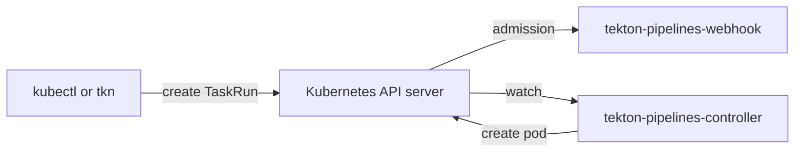

# What Tekton Is And The Tekton Ecosystem

Before you run anything with Tekton, you need a clear picture of what it is. Tekton is not one program, and it is not a server you log in to. It is a set of Kubernetes custom resources and the controllers that act on them, plus a group of related projects around them. This part gives you that picture: where Tekton comes from, what Tekton Pipelines installs in your cluster, and what the other Tekton projects do.

## A CI/CD framework built on Kubernetes

Continuous integration and delivery (CI/CD) means building, testing and releasing software automatically on every change. Tekton is an open-source framework for building CI/CD systems on Kubernetes. It does not ship a fixed build server. Instead, it gives you building blocks as Kubernetes objects, and Kubernetes runs the work as pods.

Tekton grew out of the Knative Build project at Google. It became a founding project of the Continuous Delivery Foundation (CD Foundation) in 2019, where it later graduated. In March 2026 Tekton moved to the Cloud Native Computing Foundation (CNCF), which accepted it as an **incubating** project. Both foundations are part of the Linux Foundation. So today Tekton is a CNCF incubating project, not a graduated one.

Because the building blocks are Kubernetes objects, you manage Tekton the same way you manage any other workload. You store Tasks as YAML, apply them with `kubectl`, give them permissions with role-based access control (RBAC), and read their state with `kubectl get`. The next section shows those objects.

## The custom resources of Tekton Pipelines

Tekton Pipelines is the core project. It adds new resource kinds to the Kubernetes API through custom resource definitions (CRDs). A CRD is a schema that adds a new resource kind, such as `Task`, to the Kubernetes API. List the ones Tekton installed in your playground:

<!-- astrona:playground:renew -->

```sh
kubectl get crds | grep tekton.dev
```

You see the CRDs of the API group `tekton.dev` and one of the group `resolution.tekton.dev`. These are the kinds you meet most:

| Kind | API version | What it is |
| --- | --- | --- |
| `Task` | `tekton.dev/v1` | A reusable, ordered list of steps, with parameters and results. It does nothing on its own |
| `TaskRun` | `tekton.dev/v1` | One execution of a `Task`. Tekton creates one pod for it |
| `Pipeline` | `tekton.dev/v1` | An ordered graph of Tasks |
| `PipelineRun` | `tekton.dev/v1` | One execution of a `Pipeline`. Tekton creates one `TaskRun` per Task in it |
| `StepAction` | `tekton.dev/v1beta1` | One reusable step, stored as its own object and used from a step with `ref` |
| `CustomRun` | `tekton.dev/v1beta1` | A run that a controller outside Tekton Pipelines carries out |
| `ResolutionRequest` | `resolution.tekton.dev/v1beta1` | An internal request to fetch a Task or Pipeline from a remote place |

The split between a definition and a run is the most important idea here. A `Task` is like a function: it describes work. A `TaskRun` is one call of that function, with its own inputs, its own pod and its own status. Tekton never changes a `Task` when it runs it.

## The components in the cluster

The CRDs only define kinds. The work happens in a few Deployments that the release installs. List them:

```sh
kubectl get deployments -n tekton-pipelines
kubectl get deployments -n tekton-pipelines-resolvers
```

The first command lists three Deployments in `tekton-pipelines`, and the second lists one in `tekton-pipelines-resolvers`. Each one has a separate job:

| Deployment | What it does |
| --- | --- |
| `tekton-pipelines-controller` | Watches TaskRuns and PipelineRuns, creates their pods and TaskRuns, and writes their status |
| `tekton-pipelines-webhook` | An admission webhook: the API server calls it for every Tekton object that is created or changed. It sets default values and rejects invalid objects |
| `tekton-events-controller` | Sends CloudEvents about runs, when a sink is configured |
| `tekton-pipelines-remote-resolvers` | Fetches Tasks and Pipelines from Git, an OCI bundle, Artifact Hub, an HTTP URL or another namespace |

The diagram shows what happens when you create a `TaskRun`:



The API server asks the webhook to check the new `TaskRun` first, stores it, and then the controller sees it and creates the pod.

Two more objects in `tekton-pipelines` matter from the start. The ConfigMap `config-defaults` holds default values, such as the timeout of a run. The ConfigMap `feature-flags` switches features on and off. You can read the installed version from a third ConfigMap:

```sh
kubectl get configmap pipelines-info -n tekton-pipelines -o jsonpath='{.data.version}{"\n"}'
```

The command prints `v1.17.1`, the version of Tekton Pipelines this course is written for.

## The Tekton ecosystem

Tekton Pipelines runs work, but it does not decide when to run it, show it in a browser, or sign what it built. Other Tekton projects add those jobs. Each one installs separately, and none of them is in your playground except the `tkn` command-line tool. The versions are the current ones at the time of writing:

| Project | What it does |
| --- | --- |
| Tekton Triggers (v0.37.2) | Starts PipelineRuns and TaskRuns from events, such as a webhook from a Git server |
| Tekton CLI, `tkn` (v0.46.2) | A command-line tool to start, list, describe and read the logs of Tekton objects |
| Tekton Dashboard (v0.73.0) | A web interface that shows Tekton objects and their logs |
| Tekton Catalog | A collection of community Tasks and Pipelines, published on Artifact Hub; the hub resolver fetches them |
| Tekton Chains (v0.29.9) | Watches finished runs, then signs their results and records provenance (where an artifact came from) |
| Tekton Operator (v0.81.2) | Installs, upgrades and removes Tekton projects through one custom resource |
| Pipelines-as-Code (v0.52.0) | Keeps PipelineRuns in the Git repository itself and runs them on pull requests and pushes |
| Tekton Results | Stores finished runs and their logs in a database, so you can delete them from the cluster |
| Tekton Pruner (v0.4.4) | Deletes finished TaskRuns and PipelineRuns according to rules you set |

Check the `tkn` command-line tool now. It reads your kubeconfig and asks the cluster for the installed versions:

```sh
tkn version
```

The output names the client version 0.46.2 and the version of Tekton Pipelines it found in the cluster. Like `kubectl`, `tkn` is only a client of the Kubernetes API server. It never talks to the controller directly.

You now know what Tekton is: a CNCF incubating project whose core, Tekton Pipelines, adds `Task`, `TaskRun` and other kinds to Kubernetes, with a controller that turns runs into pods and a webhook that checks objects on the way in. Around it sit separate projects for events, a user interface, signing and installation. The question still open is what the pod of a `TaskRun` looks like inside.

## Common pitfalls

> [!WARNING]
> - **Calling Tekton a CNCF graduated project.** It joined the CNCF as an incubating project in March 2026. Its graduation was at the CD Foundation, before the move.
> - **Mixing up `Task` and `TaskRun`.** A `Task` is a definition and never runs by itself. Only a `TaskRun` gets a pod.
> - **Looking for Triggers or Chains in a fresh install.** The Pipelines release installs only the controller, the webhook, the events controller and the resolvers. Every other project installs separately.
> - **Thinking `tkn` does the work.** `tkn` writes and reads objects through the API server. If the controller is stopped, `tkn` can still create a `TaskRun`, but nothing runs it.
