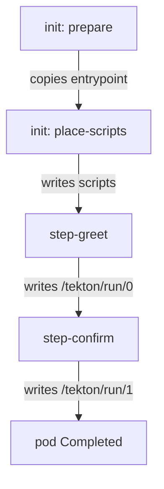

# One Pod Per TaskRun, One Container Per Step

A Tekton `Task` reads like a shell script split into parts. But each part runs in its own container, with its own image and its own file system. That design is the reason Tekton is flexible, and it is also the reason for many first mistakes: a file written in one step can vanish before the next step reads it. This part runs a small `Task`, opens the pod Tekton creates for it, and shows how the steps run in order and what they share.

## Run a hello-world Task

Start with a `Task` that has two steps. Each step names a container image and a `script`, the shell code to run in that image. A step that has a `script` runs it with `/bin/sh` unless the script starts with its own `#!` line.

<!-- astrona:playground:renew -->

Save this as `task-hello.yaml`:

```yaml
apiVersion: tekton.dev/v1
kind: Task
metadata:
  name: hello
  namespace: starfleet
spec:
  steps:
    - name: greet
      image: busybox:1.37.0
      script: |
        #!/bin/sh
        echo "Hello from the bridge"
        echo "bridge" > /workspace/crew.txt
    - name: confirm
      image: busybox:1.37.0
      script: |
        #!/bin/sh
        echo "The crew file says: $(cat /workspace/crew.txt)"
```

Apply it:

```sh
kubectl apply -f task-hello.yaml
```

Nothing runs yet. The `Task` is only stored in the API server. To run it, create a `TaskRun` that refers to it with `taskRef`.

Save this as `taskrun-hello-1.yaml`:

```yaml
apiVersion: tekton.dev/v1
kind: TaskRun
metadata:
  name: hello-1
  namespace: starfleet
spec:
  taskRef:
    name: hello
```

Apply it:

```sh
kubectl apply -f taskrun-hello-1.yaml
```

Then check the result. Wait until the `TaskRun` ends, then list it:

```sh
kubectl wait --for=condition=Succeeded taskrun/hello-1 -n starfleet --timeout=120s
kubectl get taskrun hello-1 -n starfleet
```

The `SUCCEEDED` column shows `True` and the `REASON` column shows `Succeeded`. The first run can take a little longer, because the node pulls Tekton's own helper images.

## Look inside the pod

The tekton-pipelines-controller created one pod for the `TaskRun`. Its name is the `TaskRun` name with `-pod` added, and it carries the label `tekton.dev/taskRun`. Find it and list its containers:

```sh
kubectl get pods -n starfleet -l tekton.dev/taskRun=hello-1
kubectl get pod hello-1-pod -n starfleet -o jsonpath='{.spec.initContainers[*].name}{"\n"}{.spec.containers[*].name}{"\n"}'
```

The pod shows the status `Completed`. The second command prints two lines. The first line lists the init containers `prepare` and `place-scripts`, which Tekton adds to every pod that uses scripts. The second line lists `step-greet` and `step-confirm`: one container per step, named `step-` plus the step name, in the order of the `steps` list.

Each step container keeps its own log. Read the second step's log with `kubectl`:

```sh
kubectl logs hello-1-pod -n starfleet -c step-confirm
```

It prints `The crew file says: bridge`. The second step read a file that the first step wrote, even though they are separate containers.

## How the steps run in order

Kubernetes starts all containers of a pod at the same time. Tekton still runs the steps one after the other, and a program called the **entrypoint binary** makes that happen. The `prepare` init container copies the entrypoint binary into the shared folder `/tekton/bin`. The controller then replaces the command of every step container with that binary and passes the real command as an argument.



The diagram shows the order: the init containers prepare the files, then each step starts only after the step before it wrote its marker file.

In detail, the first step waits for the file `/tekton/downward/ready`. The controller makes that file appear by setting an annotation on the pod, which Kubernetes projects into the pod through the Downward API. Each later step waits for a file that the step before it writes under `/tekton/run` when it finishes. If a step fails, it writes an error file instead, and the entrypoint binary of every later step skips its command. So a failed step stops the whole `TaskRun`, unless that step sets `onError: continue`.

## What the steps share

Steps share some folders and not others. Tekton mounts a few `emptyDir` volumes into every step container. An `emptyDir` volume is an empty folder that lives as long as the pod and that several containers can mount:

| Folder | What it is for |
| --- | --- |
| `/workspace` | Free space for your own files, shared by all steps |
| `/tekton/results` | Where steps write results, shared by all steps |
| `/tekton/home` | The home folder of the steps (old, kept for compatibility) |
| `/tekton/scripts` | The scripts from the `Task`, written by `place-scripts` |
| `/tekton/bin`, `/tekton/run`, `/tekton/steps` | The entrypoint binary and its marker files. Internal to Tekton |

Anything else lives in the container's own file system. `/tmp` in `step-greet` is a different folder from `/tmp` in `step-confirm`, because each container starts from its own image. You can see the shared folders in the volume mounts of the first step container:

```sh
kubectl get pod hello-1-pod -n starfleet -o jsonpath='{range .spec.containers[0].volumeMounts[*]}{.mountPath}{"\n"}{end}'
```

The list includes `/workspace`, `/tekton/results`, `/tekton/home`, `/tekton/scripts`, `/tekton/bin` and the `/tekton/run` folders. It does not include `/tmp`.

You now know the execution model: one pod per `TaskRun`, one container per step, init containers that prepare the entrypoint binary and the scripts, and marker files that keep the steps in order. Steps share files only through the `emptyDir` folders that Tekton mounts, such as `/workspace`. The open question is how values get into a step and how values come back out to the `TaskRun`.

## Common pitfalls

> [!WARNING]
> - **Writing a file to `/tmp` and reading it in the next step.** Each step is its own container. Use `/workspace`, which every step mounts.
> - **Looking for the logs on the `TaskRun`.** Logs belong to the step containers of the pod. Use `kubectl logs <taskrun>-pod -c step-<name>`.
> - **Expecting a `Task` to run when you apply it.** Only a `TaskRun` creates a pod.
> - **Setting `command` and `script` on the same step.** A step has one or the other; the webhook rejects both together.
> - **Leaving out both `command` and `script`.** The controller then asks the container registry for the image's entrypoint, which needs network access to the registry.
