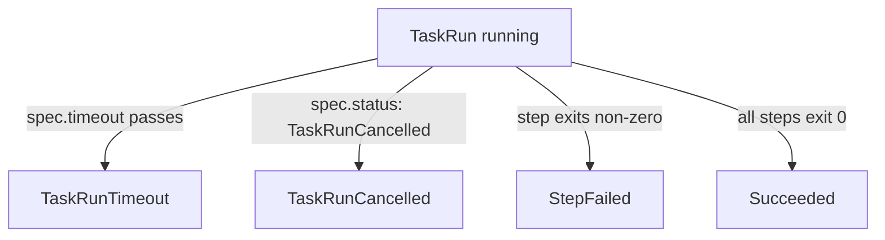

# Timeouts And Cancellation

A step that waits for a server that never answers can hold a pod, a node and a pipeline slot for hours. A CI/CD system needs two ways to end such a run: a limit that ends it by itself, and a command that ends it by hand. Tekton gives every `TaskRun` both. This part runs a Task that takes too long, ends one run with a timeout and another with a cancellation, and shows how the `Succeeded` condition tells the two apart.

## A Task that takes a long time

Start with a Task that does nothing useful except wait. It has one step and one parameter, `seconds`, which says how long the step sleeps.

<!-- astrona:playground:renew -->

Save this as `task-slow.yaml`:

```yaml
apiVersion: tekton.dev/v1
kind: Task
metadata:
  name: slow
  namespace: starfleet
spec:
  params:
    - name: seconds
      type: string
      default: "120"
  steps:
    - name: wait
      image: busybox:1.37.0
      script: |
        #!/bin/sh
        echo "Waiting for $(params.seconds) seconds"
        sleep $(params.seconds)
        echo "Done waiting"
```

Apply it:

```sh
kubectl apply -f task-slow.yaml
```

A `TaskRun` of this Task with the default value needs two minutes. The next sections end such a run early in two different ways.

## End a run with a timeout

Every `TaskRun` has a `spec.timeout`, a duration such as `20s` or `1h30m`. If the `TaskRun` is still running when the time is over, the tekton-pipelines-controller stops it and marks it as failed. You did not set a timeout in the earlier runs, so the webhook wrote the default of 60 minutes into `spec.timeout` when it accepted them. The default comes from the ConfigMap `config-defaults`, as you will see in the installation topics.

Save this as `taskrun-slow-timeout.yaml`:

```yaml
apiVersion: tekton.dev/v1
kind: TaskRun
metadata:
  name: slow-timeout
  namespace: starfleet
spec:
  timeout: 20s
  taskRef:
    name: slow
```

Apply it:

```sh
kubectl apply -f taskrun-slow-timeout.yaml
```

Then wait until the run has failed and read why. The condition `Succeeded=False` is what the wait command watches for:

```sh
kubectl wait --for=condition=Succeeded=False taskrun/slow-timeout -n starfleet --timeout=120s
kubectl get taskrun slow-timeout -n starfleet -o jsonpath='{.status.conditions[0].reason}{"\n"}{.status.conditions[0].message}{"\n"}'
```

The reason is `TaskRunTimeout`, and the message says that the `TaskRun` failed to finish within `20s`. The clock starts when the controller starts the run, so time spent on creating the pod and pulling an image counts too. A timeout that is shorter than the image pull makes every run fail.

## End a run by hand

A timeout is a decision made in advance. Sometimes you decide later, for example when you notice that a run uses the wrong parameter. For that case the `TaskRun` has a field `spec.status`. It is the one part of the `spec` that can change after the run started. Setting it to `TaskRunCancelled` tells the controller to stop the run.

Create a second run with the default two-minute wait. Save this as `taskrun-slow-cancel.yaml`:

```yaml
apiVersion: tekton.dev/v1
kind: TaskRun
metadata:
  name: slow-cancel
  namespace: starfleet
spec:
  taskRef:
    name: slow
```

Apply it:

```sh
kubectl apply -f taskrun-slow-cancel.yaml
```

Check that it is running. The `SUCCEEDED` column shows `Unknown` while the step sleeps:

```sh
kubectl get taskrun slow-cancel -n starfleet
```

Now cancel it by patching `spec.status`:

```sh
kubectl patch taskrun slow-cancel -n starfleet --type=merge -p '{"spec":{"status":"TaskRunCancelled"}}'
kubectl wait --for=condition=Succeeded=False taskrun/slow-cancel -n starfleet --timeout=60s
kubectl get taskrun slow-cancel -n starfleet -o jsonpath='{.status.conditions[0].reason}{"\n"}'
```

The reason is `TaskRunCancelled`. The run ended in seconds instead of minutes, and the controller stopped its pod. The `tkn` command-line tool has a shortcut for this patch, `tkn taskrun cancel`, which a later topic shows.



The diagram shows four ways a running `TaskRun` ends, and the reason each one writes into the `Succeeded` condition.

## Compare the three failures

You have now seen three failed runs with three different reasons. The reason tells you who ended the run: `StepFailed` means your own script ended with a non-zero exit code, `TaskRunTimeout` means the time limit ended it, and `TaskRunCancelled` means a person or a tool asked for it. Compare the times of the two runs you just made:

```sh
kubectl get taskruns slow-timeout slow-cancel -n starfleet -o custom-columns=NAME:.metadata.name,REASON:.status.conditions[0].reason,START:.status.startTime,END:.status.completionTime
```

Both rows have a start time and a completion time. The timed-out run ended about 20 seconds after it started. The cancelled run ended when you patched it.

You can now end a `TaskRun` that takes too long, either in advance with `spec.timeout` or by hand with `spec.status`, and you can tell the two apart from the reason. The open question is how a whole group of Tasks is run in a given order, because the same ideas apply there at the level of a `PipelineRun`.

## Common pitfalls

> [!WARNING]
> - **Deleting a `TaskRun` to stop it.** Deleting removes the record of the run together with its pod. Cancel it instead, so that the status and the reason stay.
> - **Setting a timeout shorter than the image pull.** The first run on a new node pulls images and counts that time.
> - **Expecting a changed default timeout to affect old runs.** The webhook writes `spec.timeout` once, when the `TaskRun` is created.
> - **Editing other fields of a started `TaskRun`.** Only `spec.status` (and `spec.statusMessage`) may change; the webhook rejects the rest.
