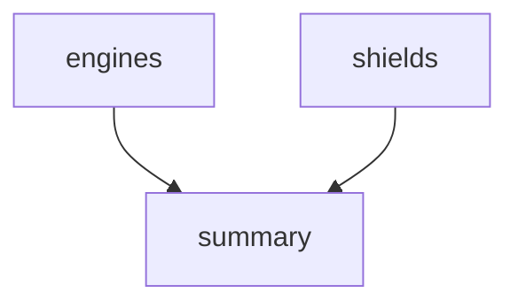

# Run Your First Pipeline

A single Task can check one system. A launch needs several checks, and a final summary that starts only after all of them. A `Pipeline` states that plan once, and the controller carries it out each time you start a `PipelineRun`. This part defines a small Pipeline, runs it, and shows which Tasks ran at the same time and which waited.

## A Task that the Pipeline reuses

A Pipeline does not contain steps. It lists *pipeline tasks*, and each one points at a `Task` with `taskRef`. So you first need a Task. This one checks one system, named by the parameter `system`, and waits a few seconds so that you can see the timing later.

<!-- astrona:playground:renew -->

Save this as `task-check.yaml`:

```yaml
apiVersion: tekton.dev/v1
kind: Task
metadata:
  name: check
  namespace: starfleet
spec:
  params:
    - name: system
      type: string
  steps:
    - name: run-check
      image: busybox:1.37.0
      script: |
        #!/bin/sh
        echo "Checking $(params.system)"
        sleep 5
        echo "$(params.system) ok"
```

Apply it:

```sh
kubectl apply -f task-check.yaml
```

## Define the Pipeline

The Pipeline has three pipeline tasks. `engines` and `shields` have no relation to each other, so Tekton may run them at the same time. `summary` has `runAfter` with both names, so it starts only after both finished successfully. Each pipeline task has a name in the Pipeline, which can differ from the name of its Task. Here three pipeline tasks use the same Task.

Save this as `pipeline-launch.yaml`:

```yaml
apiVersion: tekton.dev/v1
kind: Pipeline
metadata:
  name: launch
  namespace: starfleet
spec:
  tasks:
    - name: engines
      taskRef:
        name: check
      params:
        - name: system
          value: engines
    - name: shields
      taskRef:
        name: check
      params:
        - name: system
          value: shields
    - name: summary
      runAfter:
        - engines
        - shields
      taskRef:
        name: check
      params:
        - name: system
          value: summary
```

Apply it:

```sh
kubectl apply -f pipeline-launch.yaml
```

Like a `Task`, a `Pipeline` is only stored in the API server. Nothing runs yet.



The diagram shows the graph: `engines` and `shields` have no arrow between them, and `summary` waits for both.

## Start a PipelineRun

A `PipelineRun` refers to the Pipeline with `pipelineRef`. Save this as `pipelinerun-launch-1.yaml`:

```yaml
apiVersion: tekton.dev/v1
kind: PipelineRun
metadata:
  name: launch-1
  namespace: starfleet
spec:
  pipelineRef:
    name: launch
```

Apply it:

```sh
kubectl apply -f pipelinerun-launch-1.yaml
```

Then wait for the run and list it. The first run can take longer because the node pulls Tekton's helper images:

```sh
kubectl wait --for=condition=Succeeded pipelinerun/launch-1 -n starfleet --timeout=180s
kubectl get pipelinerun launch-1 -n starfleet
```

The `SUCCEEDED` column shows `True` and the `REASON` column shows `Succeeded`. A `PipelineRun` has a `Succeeded` condition like a `TaskRun`, and it is `Unknown` while any Task is still running.

## The TaskRuns of the run

List the TaskRuns and pods in the namespace:

```sh
kubectl get taskruns -n starfleet
kubectl get pods -n starfleet
```

There are three TaskRuns, `launch-1-engines`, `launch-1-shields` and `launch-1-summary`, and three pods, one for each. The name of a TaskRun is the name of the PipelineRun, a dash and the name of the pipeline task. You did not create these objects. The tekton-pipelines-controller created them.

Read the log of the summary pod, the same way as for a single TaskRun:

```sh
kubectl logs launch-1-summary-pod -n starfleet -c step-run-check
```

It prints `Checking summary` and `summary ok`. Everything you know about pods and step containers still applies. What the Pipeline adds is the order and the grouping.

You can now define a Pipeline, start a PipelineRun and find the TaskRuns and pods behind it. The open question is how the controller decides when to create each TaskRun, and how you can prove from the objects that `engines` and `shields` really ran together.

## Common pitfalls

> [!WARNING]
> - **Expecting one pod for the whole Pipeline.** Every pipeline task gets its own `TaskRun` and its own pod.
> - **Confusing the pipeline task name with the Task name.** `engines` is the name inside the Pipeline; `check` is the Task. TaskRuns use the pipeline task name.
> - **Forgetting `runAfter`.** Without it, or without a reference to another task's result, Tekton runs the Tasks in parallel.
> - **Applying a `Pipeline` before its Tasks exist.** The apply works, but the `PipelineRun` fails when it cannot find the Task.
