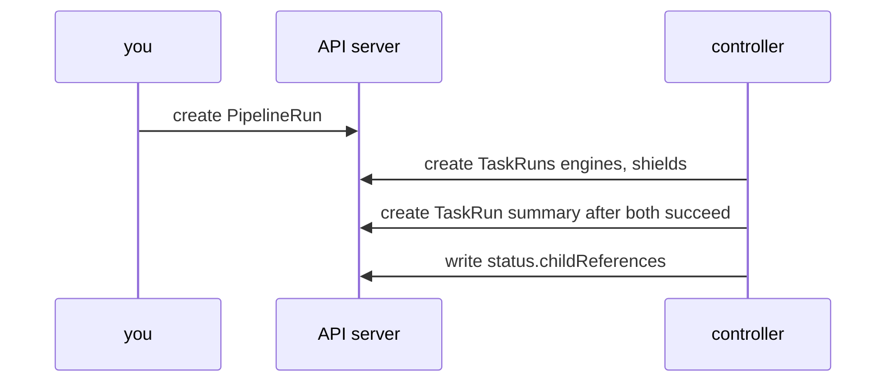

# How The Controller Builds A PipelineRun

When a `PipelineRun` fails, the first question is which Task failed and why. To answer it, you need to know which objects the controller created, how they point at each other and how to list them. This part reads those objects from the run in the previous part, `launch-1`, and uses the timestamps to prove the order.

## The objects point at each other

The tekton-pipelines-controller watches `PipelineRun` objects. For each one it works out which pipeline tasks may start, creates a `TaskRun` for each of them, and writes the outcome back into the `PipelineRun` status. The `TaskRun` objects refer to their parent in two ways.

First, every `TaskRun` has an owner reference to the `PipelineRun`. Kubernetes uses owner references for garbage collection, so deleting the `PipelineRun` deletes its TaskRuns and their pods. Second, the controller adds labels to every `TaskRun`. Read the owner and the labels of one:

<!-- astrona:playground:renew -->

```sh
kubectl get taskrun launch-1-engines -n starfleet -o jsonpath='{.metadata.ownerReferences[0].kind}{" "}{.metadata.ownerReferences[0].name}{"\n"}'
kubectl get taskrun launch-1-engines -n starfleet --show-labels
```

The owner is `PipelineRun launch-1`. The labels include `tekton.dev/pipeline=launch`, `tekton.dev/pipelineRun=launch-1` and `tekton.dev/pipelineTask=engines`. They give you three ways to list TaskRuns: by Pipeline, by run and by pipeline task. The pods carry the same labels, plus `tekton.dev/taskRun`.

```sh
kubectl get taskruns -n starfleet -l tekton.dev/pipelineRun=launch-1
kubectl get pods -n starfleet -l tekton.dev/pipelineRun=launch-1
```

## The PipelineRun status lists its children

The `PipelineRun` also keeps a list of its children in `status.childReferences`. Each entry has the kind, the name and the name of the pipeline task:

```sh
kubectl get pipelinerun launch-1 -n starfleet -o jsonpath='{range .status.childReferences[*]}{.kind}{" "}{.name}{" "}{.pipelineTaskName}{"\n"}{end}'
```

There are three lines, one for each TaskRun. This list is the fastest way from a failed `PipelineRun` to the failed `TaskRun`, because it works even after the pods are gone. The status also holds a copy of the Pipeline the run used, in `status.pipelineSpec`, so a later change to the `Pipeline` does not change a run that already started.

## Prove the order from the timestamps

Every `TaskRun` records when it started and when it finished. Print them side by side:

```sh
kubectl get taskruns -n starfleet -l tekton.dev/pipelineRun=launch-1 -o custom-columns=NAME:.metadata.name,START:.status.startTime,END:.status.completionTime
```

The start times of `launch-1-engines` and `launch-1-shields` are within a second or two of each other, because the controller created both at once. The start time of `launch-1-summary` is later than the end time of both. The controller created that TaskRun only after both dependencies had succeeded.



The diagram shows that the controller, not the user, creates every TaskRun, and that it creates `summary` only after the first two finished.

## Delete the run and see the cleanup

Because of the owner references, one delete removes the whole tree. Delete the first run and list what is left:

```sh
kubectl delete pipelinerun launch-1 -n starfleet
kubectl get taskruns,pods -n starfleet
```

All three TaskRuns and all three pods are gone. The Pipeline `launch` and the Task `check` stay, because a run does not own its definitions.

You now know how a `PipelineRun` maps to objects: owner references for cleanup, labels for listing, `childReferences` for the way back, and timestamps for the order. The open question is how the Tasks pass data to each other, since every one of them runs in its own pod.

## Common pitfalls

> [!WARNING]
> - **Listing TaskRuns by guessing names.** Use the label `tekton.dev/pipelineRun` or `status.childReferences`.
> - **Deleting a single TaskRun of a running PipelineRun.** The controller sees a child that is missing; delete or cancel the PipelineRun instead.
> - **Expecting a changed `Pipeline` to change a running `PipelineRun`.** The run keeps its own copy in `status.pipelineSpec`.
> - **Looking for the pod of a PipelineRun.** Only TaskRuns have pods.
