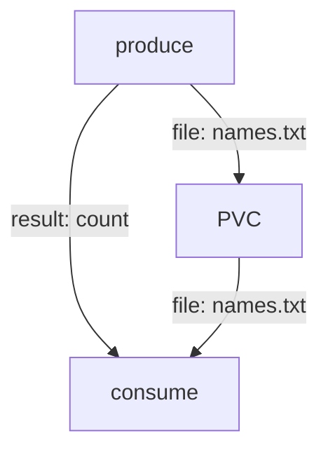

# Pass Data Between Tasks

Each Task of a Pipeline runs in its own pod. A file that one Task writes to `/workspace` is gone when its pod ends, and the next Task starts with an empty folder. A Pipeline therefore needs two other ways to move data: results for short values, and workspaces for files. This part builds a Pipeline that uses both and shows what Tekton creates for each.

## Pass a short value with a result

A result is a small named value that a step writes to `$(results.<name>.path)`. In a Pipeline, another pipeline task reads it as `$(tasks.<task>.results.<name>)`. That reference also creates an order: the consumer cannot start before the producer has finished, so you do not need `runAfter`.

<!-- astrona:playground:renew -->

Save this as `task-produce-names.yaml`:

```yaml
apiVersion: tekton.dev/v1
kind: Task
metadata:
  name: produce-names
  namespace: starfleet
spec:
  params:
    - name: crew
      type: string
  results:
    - name: count
      description: How many names were written
  workspaces:
    - name: shared
  steps:
    - name: write
      image: busybox:1.37.0
      script: |
        #!/bin/sh
        set -eu
        for name in $(params.crew); do
          echo "$name" >> $(workspaces.shared.path)/names.txt
        done
        printf '%s' "$(wc -l < $(workspaces.shared.path)/names.txt)" | tee $(results.count.path)
```

The Task `produce-names` writes each name on its own line and reports the number of lines as the result `count`. It also declares a workspace named `shared`; the next section explains it. Apply it:

```sh
kubectl apply -f task-produce-names.yaml
```

Now the consumer. Save this as `task-consume-names.yaml`:

```yaml
apiVersion: tekton.dev/v1
kind: Task
metadata:
  name: consume-names
  namespace: starfleet
spec:
  params:
    - name: count
      type: string
  results:
    - name: report
  workspaces:
    - name: shared
  steps:
    - name: read
      image: busybox:1.37.0
      script: |
        #!/bin/sh
        set -eu
        cat $(workspaces.shared.path)/names.txt
        printf '%s names, first: %s' "$(params.count)" "$(head -n 1 $(workspaces.shared.path)/names.txt)" | tee $(results.report.path)
```

Apply it:

```sh
kubectl apply -f task-consume-names.yaml
```

## Share files with a workspace

A workspace is a named folder that a Task declares and that the run provides. The Task only says "I need a folder called `shared`" and reads its path from `$(workspaces.shared.path)`. The `PipelineRun` decides what backs the folder: an `emptyDir`, an existing PersistentVolumeClaim (PVC), or a `volumeClaimTemplate` that creates a new PVC for this run. Only a PVC lets two pods see the same files, because each Task runs in a different pod.

Save this as `pipeline-pass-data.yaml`. The Pipeline declares its own workspace `shared` and hands it to both pipeline tasks. The parameter of `consume` is the result of `produce`:

```yaml
apiVersion: tekton.dev/v1
kind: Pipeline
metadata:
  name: pass-data
  namespace: starfleet
spec:
  params:
    - name: crew
      type: string
  workspaces:
    - name: shared
  tasks:
    - name: produce
      taskRef:
        name: produce-names
      params:
        - name: crew
          value: $(params.crew)
      workspaces:
        - name: shared
          workspace: shared
    - name: consume
      taskRef:
        name: consume-names
      params:
        - name: count
          value: $(tasks.produce.results.count)
      workspaces:
        - name: shared
          workspace: shared
  results:
    - name: report
      type: string
      value: $(tasks.consume.results.report)
```

Apply it:

```sh
kubectl apply -f pipeline-pass-data.yaml
```

Then save the run as `pipelinerun-pass-data-1.yaml`. Its `volumeClaimTemplate` asks Kubernetes for a small PVC:

```yaml
apiVersion: tekton.dev/v1
kind: PipelineRun
metadata:
  name: pass-data-1
  namespace: starfleet
spec:
  pipelineRef:
    name: pass-data
  params:
    - name: crew
      value: "bridge scout probe"
  workspaces:
    - name: shared
      volumeClaimTemplate:
        spec:
          accessModes:
            - ReadWriteOnce
          resources:
            requests:
              storage: 16Mi
```

Apply it:

```sh
kubectl apply -f pipelinerun-pass-data-1.yaml
```

Then check the result:

```sh
kubectl wait --for=condition=Succeeded pipelinerun/pass-data-1 -n starfleet --timeout=240s
kubectl get pipelinerun pass-data-1 -n starfleet -o jsonpath='{.status.results[?(@.name=="report")].value}{"\n"}'
```

The result is `3 names, first: bridge`. The value `3` travelled as a result from `produce` to `consume`. The names travelled as a file in the shared PVC. Look at the PVC that the controller created for this run:

```sh
kubectl get pvc -n starfleet
kubectl get pvc -n starfleet -o jsonpath='{.items[0].metadata.ownerReferences[0].kind}{" "}{.items[0].metadata.ownerReferences[0].name}{"\n"}'
```

The PVC belongs to `PipelineRun pass-data-1`, so deleting the run deletes the PVC. If a Task asks for a workspace that the run does not bind, the run fails before any pod starts; the lab shows this.



The diagram shows the two paths: the short value as a result, and the file through the PVC.

You can now move data between Tasks, and you know that the `PipelineRun` chooses the storage. The open question is what happens when one of the Tasks fails.

## Common pitfalls

> [!WARNING]
> - **Writing to `/workspace` and reading it in the next Task.** `/workspace` belongs to one pod. Use a workspace backed by a PVC.
> - **Forgetting to bind the workspace in the `PipelineRun`.** The run fails because a required workspace has no binding.
> - **Using an `emptyDir` workspace between Tasks.** It lives and dies with one pod.
> - **Referring to a result that the Task does not declare.** Spell `$(tasks.<task>.results.<name>)` exactly as in the Task's `results`.
> - **Large results.** Results are limited to 4096 bytes per pod; use a workspace for data.

## Your mission: Repair A Two-Task Pipeline

You can now pass a result and a file between two Tasks and bind a workspace in a `PipelineRun`. The graded lab gives you a Pipeline and a PipelineRun that fail, for more than one reason, and asks you to make the run succeed with the right result.

The lab runs in its own cluster, so first pause your playground. Nothing in it is lost:

```sh
astrona stop ats-124-playground-010-02
```

Then start the lab:

```sh
astrona run --git ssh://git@github.com/astrona-io/ATS124.git -c sections/section-010/module-02/labs/lab-01
```

The task is on the next page. Solve it on your own first. When you think you are done, send it for grading:

```sh
astrona submit -c sections/section-010/module-02/labs/lab-01
```

When the lab is done, remove it and start your playground again:

```sh
astrona destroy ats-124-lab-010-02
astrona start ats-124-playground-010-02
```
