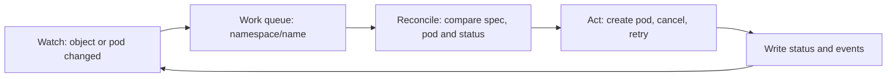

# The Reconcile Loop And The Webhook

Every object you apply passes two Tekton programs before a pod exists. The first is the webhook, which runs while the Kubernetes API server is still deciding whether to store the object. The second is the controller, which runs afterwards and keeps working on the object until the run is over. This part lists both, shows what the webhook changes and refuses, and shows what happens to new objects when the webhook is not running.

## The Deployments in tekton-pipelines

List what the release manifest installed:

<!-- astrona:playground:renew -->

```sh
kubectl get deployments,services -n tekton-pipelines
kubectl get pods -n tekton-pipelines -o wide
```

Three Deployments matter for this module:

| Deployment | What it does |
| --- | --- |
| `tekton-pipelines-controller` | Watches `TaskRun` and `PipelineRun` objects, creates pods and writes status |
| `tekton-pipelines-webhook` | Sets defaults on new objects, validates them, and converts between API versions |
| `tekton-events-controller` | Sends CloudEvents for runs, when a sink is configured |

The controller and the webhook are separate programs because they have different jobs and different failure effects. A slow controller delays runs. A broken webhook blocks the creation of every Tekton object.

## The webhook registers itself with the API server

The API server only calls the webhook because configuration objects tell it to. List them:

```sh
kubectl get mutatingwebhookconfigurations | grep tekton
kubectl get validatingwebhookconfigurations | grep tekton
```

One mutating configuration changes objects (defaulting). The validating configurations refuse objects that are wrong, and one of them checks the ConfigMaps in `tekton-pipelines`, so that a typo in `config-defaults` is refused when you apply it instead of breaking runs later. The webhook keeps its TLS certificate in the Secret `webhook-certs` in `tekton-pipelines`, and it writes the matching CA certificate into these configurations.

The CustomResourceDefinitions (CRDs) also point at the webhook. A CRD that serves more than one API version needs a conversion between the versions, and the webhook does that:

```sh
kubectl get crd tasks.tekton.dev -o jsonpath='{.spec.conversion.strategy}{"\n"}'
```

The value `Webhook` means that the API server calls the Tekton webhook to convert a stored object to the version you ask for.

## What defaulting changes

Defaulting runs before the object is stored. You can see its result without creating anything, by asking the API server for a dry run. A server-side dry run calls the webhooks, but stores nothing.

Save this as `taskrun-default.yaml`:

```yaml
apiVersion: tekton.dev/v1
kind: TaskRun
metadata:
  name: default-demo
  namespace: starfleet
spec:
  taskSpec:
    steps:
      - name: hello
        image: busybox:1.37.0
        script: |
          #!/bin/sh
          echo hello
```

Ask for the stored form:

```sh
kubectl apply -f taskrun-default.yaml --dry-run=server -o yaml
```

The file you wrote has no timeout and no ServiceAccount, and the answer has both. The webhook filled `spec.timeout` and `spec.serviceAccountName` from the ConfigMap `config-defaults`. It also filled other fields of the step. Nothing was created:

```sh
kubectl get taskruns -n starfleet
```

## What validation refuses

Validation checks the object against the rules of the API. A step without an image is one of the simplest faults. Save this as `task-invalid.yaml`:

```yaml
apiVersion: tekton.dev/v1
kind: Task
metadata:
  name: invalid
  namespace: starfleet
spec:
  steps:
    - name: no-image
      script: |
        #!/bin/sh
        echo hello
```

Try to apply it:

```sh
kubectl apply -f task-invalid.yaml
```

The API server refuses the object with an error that starts with the message `admission webhook` and names the missing field of the step. No `Task` is stored, so there is nothing to delete.

Some faults are not found at this point, because the webhook only sees one object at a time. The webhook cannot know whether the Task named in `taskRef` exists, and it cannot compare the parameters of a `TaskRun` with the parameters of its `Task`. Those checks happen in the controller, and they show up as a failed run, not as a refused object. The last part of this module uses that difference to tell the failures apart.

## The reconcile loop

The controller does not wait for commands. It keeps a local copy of the `TaskRun` and `PipelineRun` objects through the Kubernetes watch API, and it reacts to every change with the same routine:

1. A change to an object, or to a pod it owns, puts the object's key (`namespace/name`) on a work queue.
2. A worker takes a key off the queue and reads the object.
3. It compares what the object asks for with what exists: is there a pod, are the steps done, did the timeout pass.
4. It acts to close the difference, for example by creating the pod or cancelling it.
5. It writes the result into `status`, which changes the object, which can queue the key again.



The diagram shows one cycle. The routine is safe to repeat, because every pass starts from the current state and not from a memory of what it did last time. That is why the controller recovers when you restart it: the first thing it does is read every run again.

The effect is easy to see. Stop the controller, create a run, and start the controller again:

```sh
kubectl -n tekton-pipelines scale deployment tekton-pipelines-controller --replicas=0
kubectl -n tekton-pipelines rollout status deployment tekton-pipelines-controller
```

Save this as `taskrun-queued.yaml`:

```yaml
apiVersion: tekton.dev/v1
kind: TaskRun
metadata:
  name: queued
  namespace: starfleet
spec:
  taskSpec:
    steps:
      - name: hello
        image: busybox:1.37.0
        script: |
          #!/bin/sh
          echo hello from a queued run
```

Apply it and look at it:

```sh
kubectl apply -f taskrun-queued.yaml
kubectl get taskrun queued -n starfleet
```

The webhook is running, so the object was accepted and defaulted. No controller is running, so the `SUCCEEDED` column stays empty and there is no pod. Start the controller again:

```sh
kubectl -n tekton-pipelines scale deployment tekton-pipelines-controller --replicas=1
kubectl wait --for=condition=Succeeded taskrun/queued -n starfleet --timeout=120s
```

The run starts by itself and succeeds, because the controller found the object in its first pass.

## When the webhook is down

The two programs fail differently. Save this as `taskrun-webhook-test.yaml`. It uses `generateName`, so each `kubectl create` makes a new object:

```yaml
apiVersion: tekton.dev/v1
kind: TaskRun
metadata:
  generateName: webhook-test-
  namespace: starfleet
spec:
  taskSpec:
    steps:
      - name: hello
        image: busybox:1.37.0
        script: |
          #!/bin/sh
          echo hello
```

Stop the webhook, and try to create the object:

```sh
kubectl -n tekton-pipelines scale deployment tekton-pipelines-webhook --replicas=0
kubectl -n tekton-pipelines rollout status deployment tekton-pipelines-webhook
kubectl create -f taskrun-webhook-test.yaml
```

The API server refuses the object with an error that says it could not call the webhook. The webhook configurations are set to refuse objects when the webhook does not answer, so that nothing unvalidated can enter. Start the webhook again and repeat the command:

```sh
kubectl -n tekton-pipelines scale deployment tekton-pipelines-webhook --replicas=1
kubectl -n tekton-pipelines rollout status deployment tekton-pipelines-webhook
kubectl create -f taskrun-webhook-test.yaml
```

After a webhook restart, wait until the rollout is done before you create objects. The first seconds after a start also produce this kind of error, which is why the lab setup scripts in this course retry their `kubectl apply`.

You can now name the programs that handle a Tekton object, say what defaulting and validation do before it is stored, and say what the controller does afterwards. The open question is whose permissions these programs and the step pods use.

## Common pitfalls

> [!WARNING]
> - **Blaming the controller when `kubectl apply` is refused.** A refusal comes from the API server and the webhook. The controller never saw the object.
> - **Expecting the webhook to check that the `taskRef` exists.** It cannot. The missing Task shows up as a failed run.
> - **Applying objects right after a webhook restart.** Wait for `rollout status` first.
> - **Leaving a Deployment scaled to zero.** Scale the controller and the webhook back to `1` before you do anything else.
