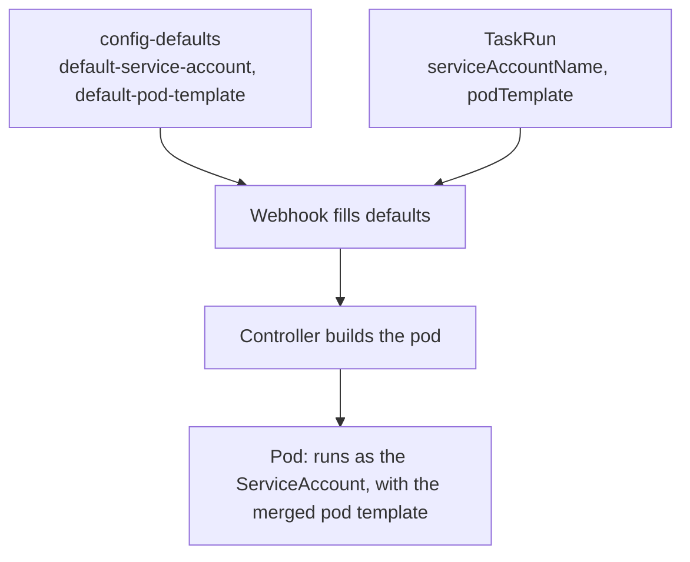

# ServiceAccounts, RBAC And The Pod Template

Two different identities are involved in every run. The controller needs permission to create pods and to write status. The steps inside the pod run with the identity of a ServiceAccount, and that identity should only be able to do what the Task needs. This part checks both identities with `kubectl auth can-i`, runs a `TaskRun` with its own ServiceAccount, and uses a pod template to change how the pod is built.

## What the controller may do

The release manifest installs ServiceAccounts, roles and bindings for each Deployment. List them:

<!-- astrona:playground:renew -->

```sh
kubectl get serviceaccounts -n tekton-pipelines
kubectl get clusterroles | grep tekton
kubectl get clusterrolebindings | grep tekton
```

Ask the API server what the controller's ServiceAccount may do. The command impersonates the ServiceAccount, and it prints `yes` or `no`:

```sh
kubectl auth can-i create pods -n starfleet --as=system:serviceaccount:tekton-pipelines:tekton-pipelines-controller
kubectl auth can-i update taskruns -n starfleet --as=system:serviceaccount:tekton-pipelines:tekton-pipelines-controller
kubectl auth can-i delete nodes --as=system:serviceaccount:tekton-pipelines:tekton-pipelines-controller
```

The first two answers are `yes`: the controller creates pods and writes `TaskRun` status in any namespace. The third answer is `no`. The controller has the permissions it needs for its job and nothing beyond it. If a pod is never created and the controller log says `forbidden`, a role was changed or removed.

## What the steps may do

The pod of a `TaskRun` does not use the controller's identity. It uses the ServiceAccount named in `spec.serviceAccountName` of the `TaskRun`. When you name none, the webhook fills in the default, which comes from `config-defaults` and is `default` unless an administrator changed it. Check which one the earlier run used:

```sh
kubectl get configmap config-defaults -n tekton-pipelines -o jsonpath='{.data.default-service-account}{"\n"}'
kubectl get serviceaccount -n starfleet
```

The first command prints the account that an administrator set. If it prints nothing, no account is set and Tekton uses `default`. The namespace `starfleet` has the ServiceAccount `default`, which every namespace has. It has no roles, so a step that talks to the Kubernetes API with it is refused.

Create a ServiceAccount for a group of Tasks and give it a single permission. Save this as `serviceaccount-builder.yaml`:

```yaml
apiVersion: v1
kind: ServiceAccount
metadata:
  name: builder
  namespace: starfleet
---
apiVersion: rbac.authorization.k8s.io/v1
kind: Role
metadata:
  name: read-configmaps
  namespace: starfleet
rules:
  - apiGroups: [""]
    resources: ["configmaps"]
    verbs: ["get", "list"]
---
apiVersion: rbac.authorization.k8s.io/v1
kind: RoleBinding
metadata:
  name: builder-read-configmaps
  namespace: starfleet
subjects:
  - kind: ServiceAccount
    name: builder
    namespace: starfleet
roleRef:
  apiGroup: rbac.authorization.k8s.io
  kind: Role
  name: read-configmaps
```

Apply it, then check what the new identity may do:

```sh
kubectl apply -f serviceaccount-builder.yaml
kubectl auth can-i list configmaps -n starfleet --as=system:serviceaccount:starfleet:builder
kubectl auth can-i list secrets -n starfleet --as=system:serviceaccount:starfleet:builder
kubectl auth can-i list configmaps -n starfleet --as=system:serviceaccount:starfleet:default
```

The answers are `yes`, `no` and `no`. A permission belongs to one ServiceAccount, and you grant it where the Task runs.

## Run a TaskRun as that ServiceAccount

Name the ServiceAccount in the `TaskRun`. Save this as `taskrun-as-builder.yaml`:

```yaml
apiVersion: tekton.dev/v1
kind: TaskRun
metadata:
  name: as-builder
  namespace: starfleet
spec:
  serviceAccountName: builder
  taskSpec:
    steps:
      - name: show-identity
        image: busybox:1.37.0
        script: |
          #!/bin/sh
          echo "service account directory:"
          ls /var/run/secrets/kubernetes.io/serviceaccount
```

Apply it and read the identity from the pod:

```sh
kubectl apply -f taskrun-as-builder.yaml
kubectl wait --for=condition=Succeeded taskrun/as-builder -n starfleet --timeout=120s
kubectl get pod as-builder-pod -n starfleet -o jsonpath='{.spec.serviceAccountName}{"\n"}'
kubectl logs as-builder-pod -n starfleet -c step-show-identity
```

The pod runs as `builder`, and the step sees the token files of that account. The pod is named after the `TaskRun` with the suffix `-pod`. A `PipelineRun` sets the same value for all its TaskRuns in `spec.taskRunTemplate.serviceAccountName`, and a single pipeline task can override it.

If the ServiceAccount named in a `TaskRun` does not exist, the run does not succeed. Read the message of its `Succeeded` condition to see which name is wrong:

```sh
kubectl get taskrun as-builder -n starfleet -o jsonpath='{.status.conditions[0].message}{"\n"}'
```

For the successful run above the message says that all steps completed.

## Change the pod with a pod template

The controller builds every pod the same way. A pod template lets one run change parts of it without changing the Task. It is a subset of a pod spec: `securityContext`, `nodeSelector`, `tolerations`, `imagePullSecrets`, `hostNetwork`, `volumes` and a few more. Save this as `taskrun-podtemplate.yaml`:

```yaml
apiVersion: tekton.dev/v1
kind: TaskRun
metadata:
  name: with-template
  namespace: starfleet
spec:
  podTemplate:
    securityContext:
      runAsUser: 1000
      runAsGroup: 3000
      fsGroup: 3000
  taskSpec:
    steps:
      - name: whoami
        image: busybox:1.37.0
        script: |
          #!/bin/sh
          echo "user: $(id -u), group: $(id -g)"
```

Apply it and compare the log with the pod:

```sh
kubectl apply -f taskrun-podtemplate.yaml
kubectl wait --for=condition=Succeeded taskrun/with-template -n starfleet --timeout=120s
kubectl logs with-template-pod -n starfleet -c step-whoami
kubectl get pod with-template-pod -n starfleet -o jsonpath='{.spec.securityContext}{"\n"}'
```

The log prints `user: 1000, group: 3000`, and the pod's `securityContext` holds the same values. The `fsGroup` matters when a workspace volume is mounted: it makes the volume writable for the group.

A `PipelineRun` passes a pod template to all its TaskRuns through `spec.taskRunTemplate.podTemplate`. An administrator can also set a default pod template for every run in `config-defaults`, with the key `default-pod-template`. A template in the run is merged over that default, and a field in the run wins.



The diagram shows where each value comes from. The run's own fields are applied over the cluster defaults, and the controller turns the result into one pod.

You can now check which identity a run uses, grant it a single permission, and change the pod of one run without touching the Task. The open question is how to follow a run while it happens.

## Common pitfalls

> [!WARNING]
> - **Giving the `default` ServiceAccount extra permissions.** Every pod in the namespace that does not name another account gets them. Create an account per purpose.
> - **Confusing the controller's permissions with the step's.** The controller creating a pod says nothing about what the steps may do.
> - **Granting a ClusterRole when a Role is enough.** Bind the narrowest role in the namespace where the Task runs.
> - **Setting `runAsUser` and expecting an image to work.** Some images need root to write where they write. Read the step log if the run fails after a pod template change.
> - **Forgetting `fsGroup` for workspaces.** A volume owned by root is not writable by a step that runs as another user.
