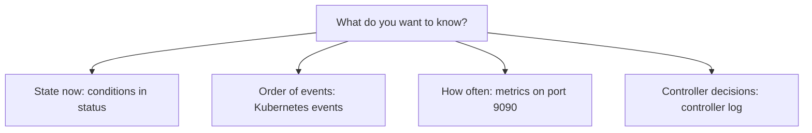

# Events, Conditions And Metrics

A run leaves evidence in four places: the conditions in its status, Kubernetes events, the controller's metrics and the controller's log. They answer different questions. The condition says what the state is now, events say what happened in which order, metrics say how often it happens across all runs, and the log says what the controller was thinking. This part reads each one for the same run.

## A run to look at

Save this as `task-signal.yaml`. It has a step that succeeds, a parameter that decides whether a second step fails, and a short sleep so that the run is visible while it runs:

```yaml
apiVersion: tekton.dev/v1
kind: Task
metadata:
  name: signal
  namespace: starfleet
spec:
  params:
    - name: outcome
      type: string
      default: pass
  steps:
    - name: work
      image: busybox:1.37.0
      script: |
        #!/bin/sh
        echo "working"
        sleep 5
    - name: finish
      image: busybox:1.37.0
      script: |
        #!/bin/sh
        if [ "$(params.outcome)" = "fail" ]; then
          echo "finishing with an error"
          exit 1
        fi
        echo "finished"
```

<!-- astrona:playground:renew -->

Apply it and start one run that passes and one that fails. Use `tkn` to start them with a generated name:

```sh
kubectl apply -f task-signal.yaml
tkn task start signal -n starfleet --use-param-defaults --prefix-name signal-pass
tkn task start signal -n starfleet -p outcome=fail --prefix-name signal-fail
```

Each command prints the name of the new `TaskRun`, which begins with the prefix. Wait for both to finish:

```sh
kubectl get taskruns -n starfleet
```

## Conditions: the state now

Each `TaskRun` has a list `status.conditions`. Tekton writes one condition of type `Succeeded`. Its `status` is `Unknown` while the run works, and `True` or `False` when it is done. Its `reason` and `message` say why:

```sh
kubectl get taskruns -n starfleet -o custom-columns=NAME:.metadata.name,STATUS:.status.conditions[0].status,REASON:.status.conditions[0].reason
```

The passing run has `True`. The failing run has `False`, and its reason and message say that a step failed. The condition does not say which step. For that, read `status.steps` of the failed run. List the runs of the Task and pick the failed one:

```sh
kubectl get taskruns -n starfleet -l tekton.dev/task=signal
```

Save the name of the failed run in a shell variable, and read its steps:

```sh
FAILED=$(kubectl get taskruns -n starfleet -l tekton.dev/task=signal -o jsonpath='{.items[?(@.status.conditions[0].status=="False")].metadata.name}')
echo "$FAILED"
kubectl get taskrun "$FAILED" -n starfleet -o jsonpath='{range .status.steps[*]}{.name}{" "}{.terminated.exitCode}{"\n"}{end}'
```

The step `work` ended with exit code `0` and the step `finish` with exit code `1`.

A condition only shows the current state. Once a run is over, the condition does not tell you what happened first.

## Events: what happened in which order

The controller also writes Kubernetes events on the `TaskRun`. Events are separate objects with a time stamp, a reason and a message. List the ones for your runs, oldest first:

```sh
kubectl get events -n starfleet --field-selector involvedObject.kind=TaskRun --sort-by=.lastTimestamp
```

For each run you see a short sequence of events with the reasons `Started`, `Running` and then `Succeeded` or `Failed`. The events of the pod itself, such as pulling an image, are separate, because they belong to the pod:

```sh
kubectl get events -n starfleet --field-selector involvedObject.kind=Pod --sort-by=.lastTimestamp
```

Kubernetes keeps events for a short time, one hour by default. Use them while you debug, and do not treat them as a record.

When a run does not start at all, `kubectl describe` shows the object together with its events in one place:

```sh
kubectl describe taskruns -n starfleet -l tekton.dev/task=signal
```

## CloudEvents: telling other systems

Kubernetes events stay inside the cluster. To tell another system, such as a dashboard or a chat bot, Tekton sends CloudEvents over HTTP. The `tekton-events-controller` sends them to the address in the key `sink` of the ConfigMap `config-events`. Without a sink, nothing is sent:

```sh
kubectl get configmap config-events -n tekton-pipelines -o jsonpath='{.data.sink}{"\n"}'
```

The command prints an empty line in a fresh installation. The events are sent for the same state changes as the Kubernetes events, as a POST request to the sink.

## Metrics: how often, across all runs

The controller exposes Prometheus metrics on port `9090` of its pod, under the path `/metrics`. They count runs and measure durations across all namespaces. Open a port to the pod in one terminal:

```sh
kubectl port-forward -n tekton-pipelines deployment/tekton-pipelines-controller 9090:9090
```

In a second terminal, read the endpoint and keep the Tekton lines:

```sh
curl -s localhost:9090/metrics | grep '^tekton'
```

The metric names start with `tekton_pipelines_controller_`, and they cover `TaskRun` and `PipelineRun` counts, durations, running runs and pod latency. Run the command again after you start another run and compare the counters. Stop the port forward with Ctrl+C when you are done.

Metrics answer questions about the system, such as how many runs fail per hour. They cannot tell you why one specific run failed. The usual way to collect them is a Prometheus server that scrapes the endpoint; the observability topic in the installation section shows which ConfigMap controls what the controller exposes.

## The controller log: what it was thinking

The controller writes structured logs. The most useful lines carry the key of the object, written as `namespace/name`. Filter the log for a run:

```sh
kubectl logs -n tekton-pipelines deployment/tekton-pipelines-controller --since=15m | grep starfleet/signal
```

Most lines of a healthy run are routine. The lines of a failing run name the step or the pod that caused the failure. Read the log last, when the condition and the events do not explain the problem.



The diagram shows one question for each signal. You pick the source by the question.

You can now read all four signals for a run. The open question is the order in which to read them when something fails.

## Common pitfalls

> [!WARNING]
> - **Looking for old events.** Kubernetes removes events after about an hour. Use the condition and `status` for runs that ended earlier.
> - **Expecting CloudEvents without a sink.** With no `sink` in `config-events`, nothing is sent.
> - **Reading metrics for one run.** The endpoint counts all runs. It cannot say why a run failed.
> - **Forgetting to stop the port forward.** The command runs until you press Ctrl+C.
> - **Searching the controller log first.** It is the largest source and the least specific. Start with the condition.
