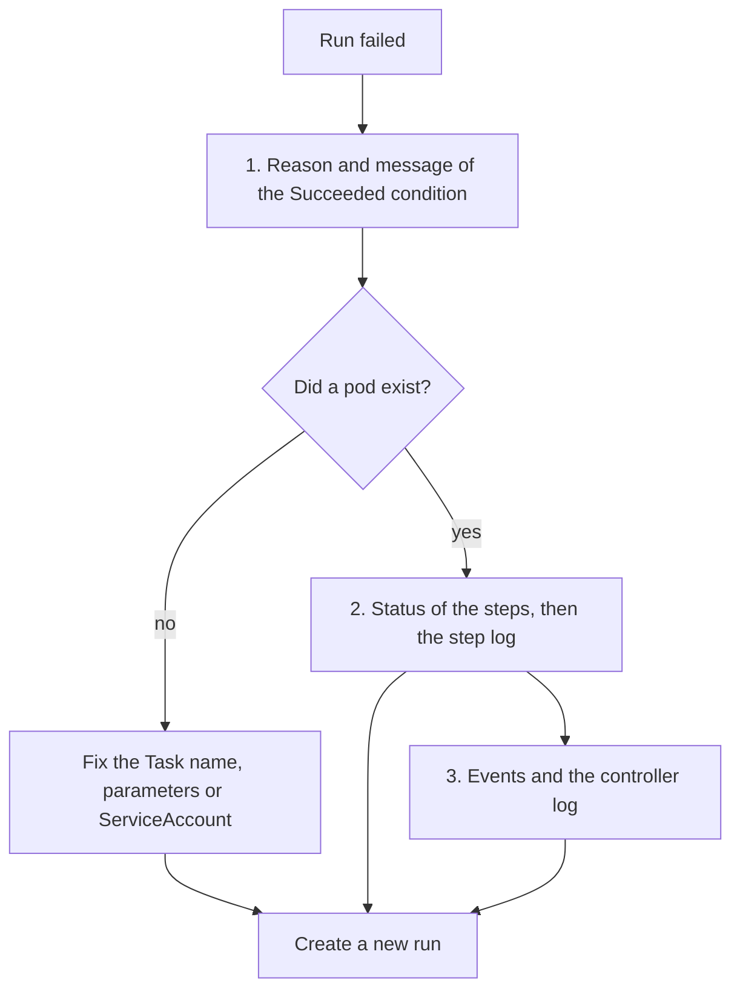

# Where To Look First

A failed run gives you four pieces of evidence and a lot of places to look. Reading them in a fixed order saves time, because each step either finds the cause or tells you where to go next. This part causes four different failures on purpose, reads the reason of each, and builds the triage routine from what you see.

## Four Tasks and four faults

Save this as `triage-tasks.yaml`. The Task `greet` needs a parameter, the Task `break` always fails, and the Task `nap` sleeps longer than the timeout you will give it:

```yaml
apiVersion: tekton.dev/v1
kind: Task
metadata:
  name: greet
  namespace: starfleet
spec:
  params:
    - name: who
      type: string
  steps:
    - name: hello
      image: busybox:1.37.0
      script: |
        #!/bin/sh
        echo "hello $(params.who)"
---
apiVersion: tekton.dev/v1
kind: Task
metadata:
  name: break
  namespace: starfleet
spec:
  steps:
    - name: boom
      image: busybox:1.37.0
      script: |
        #!/bin/sh
        echo "about to fail"
        exit 1
---
apiVersion: tekton.dev/v1
kind: Task
metadata:
  name: nap
  namespace: starfleet
spec:
  steps:
    - name: sleep
      image: busybox:1.37.0
      script: |
        #!/bin/sh
        sleep 120
```

<!-- astrona:playground:renew -->

Apply them:

```sh
kubectl apply -f triage-tasks.yaml
```

Now save this as `triage-runs.yaml`. Each TaskRun has one fault:

```yaml
apiVersion: tekton.dev/v1
kind: TaskRun
metadata:
  name: t-missing-task
  namespace: starfleet
spec:
  taskRef:
    name: does-not-exist
---
apiVersion: tekton.dev/v1
kind: TaskRun
metadata:
  name: t-missing-param
  namespace: starfleet
spec:
  taskRef:
    name: greet
---
apiVersion: tekton.dev/v1
kind: TaskRun
metadata:
  name: t-step-fails
  namespace: starfleet
spec:
  taskRef:
    name: break
---
apiVersion: tekton.dev/v1
kind: TaskRun
metadata:
  name: t-too-slow
  namespace: starfleet
spec:
  timeout: 15s
  taskRef:
    name: nap
```

Apply them and wait until all four have ended:

```sh
kubectl apply -f triage-runs.yaml
kubectl wait --for=condition=Succeeded=False taskrun --all -n starfleet --timeout=180s
```

## Read the reason first

One command shows the reason of every run:

```sh
kubectl get taskruns -n starfleet -o custom-columns=NAME:.metadata.name,STATUS:.status.conditions[0].status,REASON:.status.conditions[0].reason
```

The reasons are different, and each one points at a different place:

| Run | Reason | What it means | Where to look next |
| --- | --- | --- | --- |
| `t-missing-task` | `TaskRunResolutionFailed` | The controller could not find the Task named in `taskRef` | `kubectl get tasks -n starfleet`, then the spelling and the namespace |
| `t-missing-param` | `TaskRunValidationFailed` | The `TaskRun` and its `Task` do not fit together | The message names the parameter; compare `spec.params` with the Task's `params` |
| `t-step-fails` | `StepFailed` | A step ran and exited with a non-zero code | The log of the step container |
| `t-too-slow` | `TaskRunTimeout` | The run took longer than `spec.timeout` | The timeout value and what the step waits for |

The reason tells you who is responsible before you open any log. The first two failures happened before any step ran, so there is nothing in a log to read. The last two happened while the pod existed.

## Read the message second

The message adds the detail that the reason leaves out:

```sh
kubectl get taskrun t-missing-task -n starfleet -o jsonpath='{.status.conditions[0].message}{"\n"}'
kubectl get taskrun t-missing-param -n starfleet -o jsonpath='{.status.conditions[0].message}{"\n"}'
```

The first message names the Task that was not found. The second names the parameter without a value. Fix by reading the name, not by guessing.

The objects tell you whether a pod ever existed. A failure before the pod leaves no pod:

```sh
kubectl get pods -n starfleet
```

The list holds the pod of `t-step-fails`, and none for `t-missing-task` and `t-missing-param`. A timed-out run is different again: the controller stops its pod when the time is over, so do not count on finding a log for it.

## Read the step and the log third

For the run whose step failed, find the step that ended and read its log:

```sh
kubectl get taskrun t-step-fails -n starfleet -o jsonpath='{range .status.steps[*]}{.name}{" exit="}{.terminated.exitCode}{"\n"}{end}'
kubectl logs t-step-fails-pod -n starfleet -c step-boom
```

The step `boom` ended with exit code `1`, and its log holds `about to fail`. For `t-too-slow` the answer is in the condition, not in a log: the reason says that the run took longer than its timeout, and the step was stopped from outside.

## Events and the controller log last

When the condition, the message and the log do not explain a run, widen the search. The events show what the controller and the pod did around the failure, and the controller log shows its decisions:

```sh
kubectl describe taskrun t-missing-param -n starfleet
kubectl logs -n tekton-pipelines deployment/tekton-pipelines-controller --since=15m | grep starfleet/t-missing-param
```

For these four runs the first two checks were enough. The last check is for the rare case where a run hangs with `Unknown`, for example when the pod cannot be scheduled.



The diagram shows the routine: reason first, then the pod and its log, then the wider evidence. A failed run is never edited and started again. You fix the cause and create a new run.

## Fix the faults with new runs

A started `TaskRun` cannot be changed, so each fix is a new object. Save this as `triage-fixed.yaml`:

```yaml
apiVersion: tekton.dev/v1
kind: TaskRun
metadata:
  name: t-fixed
  namespace: starfleet
spec:
  taskRef:
    name: greet
  params:
    - name: who
      value: warp
```

Apply it and read the log:

```sh
kubectl apply -f triage-fixed.yaml
kubectl wait --for=condition=Succeeded taskrun/t-fixed -n starfleet --timeout=120s
kubectl logs t-fixed-pod -n starfleet -c step-hello
```

The log prints `hello warp`. The four failed runs are still there, with their reasons, as a record of what happened.

## Common pitfalls

> [!WARNING]
> - **Opening the pod log for a failure that happened before the pod.** There is no pod for a resolution or validation failure. Read the condition message.
> - **Reading the controller log first.** It is the largest and least specific source.
> - **Editing a failed `TaskRun` to rerun it.** Create a new one and keep the old one as evidence.
> - **Looking for the answer in a log after a timeout or a cancellation.** The controller stops the pod from outside, so the answer is in the condition.
> - **Raising the timeout without checking why the step is slow.** A longer limit hides the problem for a while.

## Your mission: Triage Four Failed Runs

You can now read a failed run in a fixed order and tell the four common failure kinds apart by their reasons. The graded lab gives you four failed `TaskRuns` you have not seen before and asks you to record the reason of each and to create a run that works.

The lab runs in its own cluster, so first pause your playground. Nothing in it is lost:

```sh
astrona stop ats-124-playground-010-03
```

Then start the lab:

```sh
astrona run --git ssh://git@github.com/astrona-io/ATS124.git -c sections/section-010/module-03/labs/lab-01
```

The task is on the next page. Solve it on your own first. When you think you are done, send it for grading:

```sh
astrona submit -c sections/section-010/module-03/labs/lab-01
```

When the lab is done, remove it and start your playground again:

```sh
astrona destroy ats-124-lab-010-03
astrona start ats-124-playground-010-03
```
