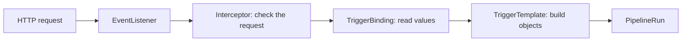

# Triggers: From Event To Run

A webhook call from a Git host, a chat command or a timer can all be the start of a pipeline. Triggers turns such an event into a `PipelineRun`.

## The objects

| Object | Job |
| --- | --- |
| `EventListener` | Listens for HTTP requests and holds the list of triggers |
| `Trigger` or an inline trigger | Joins a binding and a template, with optional interceptors |
| `TriggerBinding` | Reads values from the request body and headers into parameters |
| `TriggerTemplate` | A template of the objects to create, usually a `PipelineRun`, with parameters |
| Interceptor | Checks or changes the request before the template is used |

When you create an `EventListener`, Triggers creates a Deployment and a Service for it, named `el-` plus the name of the listener.



The diagram shows one request on its way to a run. An interceptor can stop it, for example when a signature does not match.

## Why the split

The binding knows the shape of the request, and the template knows the shape of the run. A new Git host needs a new binding only. A new pipeline needs a new template only.

## Look at the objects in your playground

The objects are custom resources, so Kubernetes can describe them once Triggers is installed. The next part installs it. Until then, you can check that the Pipelines side is ready:

<!-- astrona:playground:renew -->

```sh
kubectl get crds | grep tekton.dev
```

The list shows the Pipelines CRDs. After the next part it also shows `eventlisteners.triggers.tekton.dev`, `triggerbindings.triggers.tekton.dev` and `triggertemplates.triggers.tekton.dev`.

## Security

The `EventListener` runs as a ServiceAccount that must be allowed to create the objects in the template. Give it only that. The listener accepts requests from anywhere that can reach its Service, so protect it with an interceptor that checks a shared secret or a signature.

## Common pitfalls

> [!WARNING]
> - **Exposing a listener without an interceptor.** Anyone who can reach it can start runs.
> - **A ServiceAccount with too many rights.** It should create the template's objects and nothing else.
> - **Putting logic in the template.** Keep it in the Pipeline; the template only fills parameters.
