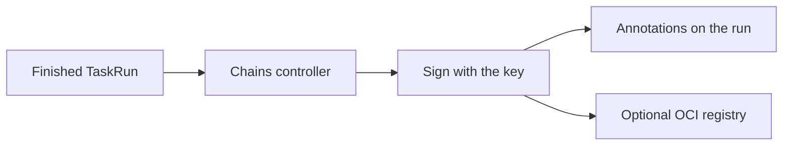

# Chains: Sign What Runs Produce

A finished run is evidence of how something was built. Tekton Chains watches finished `TaskRuns` and `PipelineRuns`, records what they did, and signs the record.

## What Chains does

When a run finishes, Chains takes a snapshot of it, signs the snapshot with a key, and stores the signature and the attestation. An attestation is a signed statement about the run. Supply-chain tools use it to check that an image came from the pipeline you trust. If a Task writes the results `IMAGE_URL` and `IMAGE_DIGEST`, Chains also signs that image.



## Install and configure

<!-- astrona:playground:renew -->

```sh
kubectl apply -f https://storage.googleapis.com/tekton-releases/chains/latest/release.yaml
```

Chains runs in the namespace `tekton-chains`. Its settings are in the ConfigMap `chains-config`. Three keys decide the output: the format of the attestation, the place where it is stored and the signer. For example, `artifacts.taskrun.format: in-toto` and `artifacts.taskrun.storage: tekton` keep the record in annotations on the `TaskRun` itself.

The signing key is a secret named `signing-secrets`. The `cosign` tool can create it in the cluster:

```sh
cosign generate-key-pair k8s://tekton-chains/signing-secrets
```

## See that a run was signed

After a run finishes, Chains marks it with an annotation:

```sh
kubectl get taskrun NAME -n starfleet -o jsonpath='{.metadata.annotations.chains\.tekton\.dev/signed}{"\n"}'
```

Replace `NAME` with a finished run. The value is `true` once Chains has signed it.

## Triggers or Chains

Triggers acts before a run: an event starts it. Chains acts after: the result is signed. They do not depend on each other, and both need Pipelines.

You can now name what Triggers and Chains add to Tekton Pipelines and where each fits.

## Common pitfalls

> [!WARNING]
> - **Losing the private key.** Old signatures cannot be re-created and the secret is the only copy.
> - **Expecting Chains to sign runs that existed before it was installed.** It acts on runs it sees finish.
> - **Storing the key in a ConfigMap.** Use a Secret.
