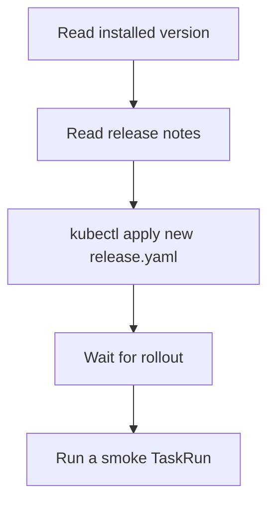

# Upgrade And Uninstall Tekton Pipelines

An installation is not finished when the first TaskRun succeeds. Tekton publishes a new release every month, security fixes arrive in patch releases, and one day the cluster must be cleaned up. This part shows how to read the installed version, how an upgrade works with the same `kubectl apply` that installed Tekton, which checks to run after it, and what an uninstall removes.

## Read the installed version

Before any change, write down what runs now. The release manifest stores its version in the ConfigMap `pipelines-info`, and every Tekton Deployment carries the version as a label.

<!-- astrona:playground:renew -->

```sh
kubectl get configmap pipelines-info -n tekton-pipelines -o jsonpath='{.data.version}{"\n"}'
kubectl get deployment tekton-pipelines-controller -n tekton-pipelines -o jsonpath='{.metadata.labels.app\.kubernetes\.io/version}{"\n"}'
```

Both commands print the same version, for example `v1.17.1`. The controller image in the Deployment also names the version, and its digest pins the exact build:

```sh
kubectl get deployment tekton-pipelines-controller -n tekton-pipelines -o jsonpath='{.spec.template.spec.containers[0].image}{"\n"}'
```

## How an upgrade works

Tekton has no upgrade command. A release manifest is a list of Kubernetes objects, so you upgrade by applying the manifest of the new version over the old one. `kubectl apply` compares each object with the live object and changes what differs: the CustomResourceDefinitions (CRDs), the Deployments with their new images, the ConfigMaps and the roles.

The manifests live in a folder per version. The folder `previous/<version>/` holds one release, and the folder `latest/` always holds the newest one. A production cluster should always name the version, so that the same command gives the same result next week:

```text
kubectl apply -f https://infra.tekton.dev/tekton-releases/pipeline/previous/<VERSION>/release.yaml
```

Replace `<VERSION>` with a release that exists, such as the one you are about to move to. Do not run this line in the playground unchanged; the course material is written for v1.17.1.



The diagram shows the order of an upgrade: read the version, read the release notes of every release in between, apply, wait for the Deployments, and prove the result with a run.

Three rules keep an upgrade safe. Read the release notes first, because they list removed fields and changed defaults. Move one release line at a time rather than jumping across many. Prefer a long-term support (LTS) release for a production cluster, because LTS releases get patches for a year while a monthly release is supported for about two months.

## Check after the upgrade

After the apply, wait for the three Deployments in `tekton-pipelines` and the resolvers Deployment, then run the same smoke test you used after the first installation. The commands below work after any release:

```sh
kubectl rollout status deployment/tekton-pipelines-controller -n tekton-pipelines --timeout=300s
kubectl rollout status deployment/tekton-pipelines-webhook -n tekton-pipelines --timeout=300s
kubectl rollout status deployment/tekton-events-controller -n tekton-pipelines --timeout=300s
kubectl rollout status deployment/tekton-pipelines-remote-resolvers -n tekton-pipelines-resolvers --timeout=300s
```

A `TaskRun` that was running during the upgrade is not lost. Its pod keeps running, and the new controller picks the `TaskRun` up again from its stored status. Objects that were created earlier keep their stored `spec`, so a changed default affects only new objects.

To go back, apply the manifest of the older version in the same way. Rolling back is safe only between releases that do not change the stored form of the CRDs, which the release notes say.

## What an uninstall removes

You uninstall with the same manifest that you used to install, but with `kubectl delete`. Because the manifest contains the CRDs, the delete removes every Tekton object in the cluster too, in all namespaces: each `Task`, `TaskRun`, `Pipeline` and `PipelineRun` is deleted together with its definition.

```text
kubectl delete -f https://infra.tekton.dev/tekton-releases/pipeline/previous/v1.17.1/release.yaml
```

Run it only in a cluster you can throw away. The line is shown as text on purpose. Export what you need first, for example with `kubectl get tasks,pipelines -A -o yaml`. If the namespace `tekton-pipelines` stays in the state `Terminating`, an object in it still has a finalizer; list the leftovers with `kubectl api-resources --verbs=list --namespaced -o name`.

You can now read the installed version, upgrade by applying a newer manifest, check the result, and name what an uninstall deletes. The open question is how to see what the installation does while it runs: its logs, its metrics and its high-availability settings.

## Common pitfalls

> [!WARNING]
> - **Applying `latest` in production.** The same command installs a different version next month. Name the version.
> - **Skipping the release notes.** A field that was deprecated for several releases can be removed.
> - **Deleting the release manifest to "reset" Tekton.** It also deletes every `Task`, `TaskRun`, `Pipeline` and `PipelineRun`.
> - **Upgrading without a smoke test.** A healthy Deployment does not prove that the webhook accepts objects. Run a `TaskRun`.
