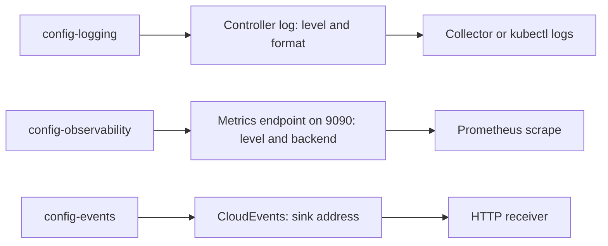

# Logging And Observability

When a run behaves in a way you do not understand, the controller log is the place where its decisions are written. By default the log shows little. This part raises the log level for a short time, reads the effect, sets it back, and shows which ConfigMap decides what the metrics endpoint exposes.

## The ConfigMaps that belong to logging and metrics

List all ConfigMaps in the Tekton namespace and pick the ones that carry settings for the Deployments:

<!-- astrona:playground:renew -->

```sh
kubectl get configmaps -n tekton-pipelines
```

Besides `config-defaults` and `feature-flags`, you will see `config-logging`, `config-observability`, `config-events`, the leader election ConfigMaps, and `config-trusted-resources`, `config-spire` and others for features that are off by default. The Deployments watch the ConfigMaps they use, and apply a change without a restart.

## The controller log

The log of the controller is structured JSON, one object per line. Read the last lines:

```sh
kubectl logs -n tekton-pipelines deployment/tekton-pipelines-controller --tail=5
```

Each line has a level, a time stamp, a logger name and a message. Lines about an object carry its key as `namespace/name`.

The level is set in the ConfigMap `config-logging`. Read it:

```sh
kubectl get configmap config-logging -n tekton-pipelines -o yaml
```

The key `zap-logger-config` holds the logger settings as JSON, and one key per component holds its level, such as `loglevel.controller` and `loglevel.webhook`. The levels are `debug`, `info`, `warn`, `error`, `dpanic`, `panic` and `fatal`.

## Raise the level for one component

Start a run so that there is something to read, then raise the level of the controller:

```sh
kubectl patch configmap config-logging -n tekton-pipelines --type=merge -p '{"data":{"loglevel.controller":"debug"}}'
```

Count the lines the controller writes in a quiet minute before and after the change. Run a short TaskRun between the two readings. Save this as `taskrun-log-demo.yaml`:

```yaml
apiVersion: tekton.dev/v1
kind: TaskRun
metadata:
  generateName: log-demo-
  namespace: starfleet
spec:
  taskSpec:
    steps:
      - name: hello
        image: busybox:1.37.0
        script: |
          #!/bin/sh
          echo hello
```

Create it, wait a moment, and count the lines at each level:

```sh
kubectl create -f taskrun-log-demo.yaml
sleep 20
kubectl logs -n tekton-pipelines deployment/tekton-pipelines-controller --since=30s | grep -c '"level":"debug"'
```

The count is larger than zero after the change. Debug lines show the controller's decisions in detail, such as which pod it looked for and why it did not act. The cost is volume: a busy installation writes far more, and the lines can include object contents. Keep `debug` for a short investigation.

Set the level back when you are done:

```sh
kubectl patch configmap config-logging -n tekton-pipelines --type=merge -p '{"data":{"loglevel.controller":"info"}}'
```

The same pattern works for the webhook with `loglevel.webhook`. Because the ConfigMap is watched, the change reaches the running process, and you do not restart anything.

## What a pod log is not

The log of the controller is not the log of your steps. A step writes to its own container, and you read it with `kubectl logs <pod> -c step-<name>`. When a pod is gone, its step logs are gone too, unless a log collector copied them to storage. Tekton does not store step logs. The Dashboard and `tkn taskrun logs` read them from the pod while the pod exists. A cluster that must keep logs needs a collector that runs on every node and ships container logs to a store.

## The observability ConfigMap

The metrics you read on port `9090` in the earlier module are controlled by `config-observability`:

```sh
kubectl get configmap config-observability -n tekton-pipelines -o yaml
```

The keys differ a little between releases, so read the `_example` text in your own installation. They cover three decisions: where the metrics go (the `metrics.backend-destination` key, `prometheus` by default), how detailed the `TaskRun` and `PipelineRun` metrics are (the `metrics.taskrun.level` and `metrics.pipelinerun.level` keys), and whether durations are recorded as histograms or as gauges (the `duration-type` keys).

The level matters for cost. A metric with a label for every `TaskRun` name has one time series for each run, which grows without limit. A level that groups by Task, or only by namespace, keeps the number of series small. Choose the coarsest level that answers your questions.



The diagram shows three ConfigMaps for three outputs. Each output has its own consumer, and each consumer needs its own setup outside Tekton.

You can now change what the controller logs, and say where the metrics and events settings live. The open question is how to keep the controller running when one pod fails.

## Common pitfalls

> [!WARNING]
> - **Leaving `debug` on.** The log grows quickly and may contain object contents. Set the level back to `info`.
> - **Expecting step logs to outlive the pod.** Tekton does not store them. Use a log collector for that.
> - **Restarting the controller after a ConfigMap change.** It is not needed; the Deployment watches the ConfigMap.
> - **Using the most detailed metric level on a busy cluster.** The number of time series grows with every run.
> - **Editing a ConfigMap that an operator owns.** The operator may write the old value back; see the last part of this module.
