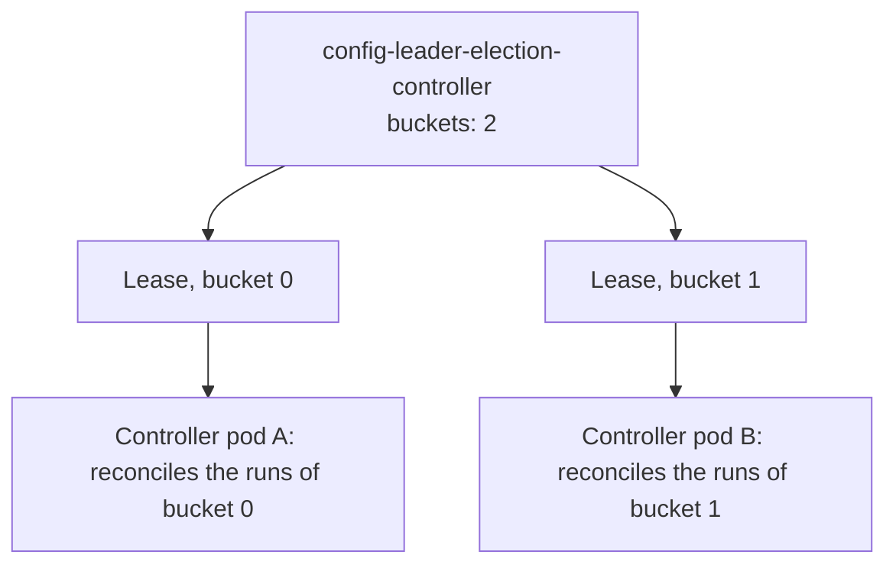

# High Availability And Leader Election

With one replica of the controller, a node failure stops every run until Kubernetes starts a new pod. With more replicas, another pod can take over in seconds. This part scales the controller to two replicas, shows how the replicas share the work through Lease objects, and stops the pod that leads to prove that runs continue.

## One controller works, two must agree

If two controller pods reconciled the same `TaskRun`, both would try to create its pod and both would write its status. To avoid that, the replicas use **leader election**. Each replica asks to hold a Lease, which is a small Kubernetes object with a name, a holder and a time stamp. The replica that holds a Lease does the work that the Lease stands for, and renews the Lease on a timer. A replica that stops renewing loses it, and another replica takes it over.

The timers and the number of parts the work is split into are set in ConfigMaps. List them:

<!-- astrona:playground:renew -->

```sh
kubectl get configmaps -n tekton-pipelines | grep leader-election
kubectl get configmap config-leader-election-controller -n tekton-pipelines -o yaml
```

The ConfigMap is a set of keys, with built-in values you can see in the `_example` text. The keys that matter are these:

| Key | What it sets |
| --- | --- |
| `lease-duration` | How long a Lease is valid after the holder's last renewal |
| `renew-deadline` | How long the holder keeps trying to renew before it gives up |
| `retry-period` | How often a replica tries to take or renew a Lease |
| `buckets` | Into how many parts the controller's work is split, between 1 and 10 |

A longer `lease-duration` means fewer API calls and a slower failover. A shorter one means a faster failover and a higher risk that a slow API server makes a healthy leader lose its Lease.

## Look at the leases

With one replica, every Lease has the same holder. List them with their holders:

```sh
kubectl get leases -n tekton-pipelines -o custom-columns=NAME:.metadata.name,HOLDER:.spec.holderIdentity
```

The holder identity starts with the name of a pod. Check the pod name:

```sh
kubectl get pods -n tekton-pipelines -l app.kubernetes.io/name=controller
```

## Run two replicas

Scale the controller to two replicas and wait until both are ready:

```sh
kubectl -n tekton-pipelines scale deployment tekton-pipelines-controller --replicas=2
kubectl -n tekton-pipelines rollout status deployment tekton-pipelines-controller
kubectl get pods -n tekton-pipelines -l app.kubernetes.io/name=controller
```

The second pod is ready, but it holds no Lease while the first one holds all of them. It is a standby. List the leases again:

```sh
kubectl get leases -n tekton-pipelines -o custom-columns=NAME:.metadata.name,HOLDER:.spec.holderIdentity
```

Every Lease still has the same holder. With `buckets` at `1`, the controller's work is one part and one replica leads it.

## Spread the work with buckets

To use both replicas, set `buckets` to the number of replicas:

```sh
kubectl patch configmap config-leader-election-controller -n tekton-pipelines --type=merge -p '{"data":{"buckets":"2"}}'
```

The Deployment watches the ConfigMap. After a short time, the reconcilers divide their Leases into two buckets, and each bucket has its own Lease. List them again, and look at the holders. Both pods now appear. Each `TaskRun` belongs to exactly one bucket, decided by a hash of its key, so only one replica works on it.



The diagram shows two buckets, each with a Lease and a holder. If a pod fails, the other one takes over its Lease after the lease duration, and works on both buckets until a replacement starts.

Set the number of buckets equal to the number of replicas. More buckets than replicas works, but one pod then holds several. Fewer buckets than replicas leaves some replicas idle.

## Prove the failover

Find the pod that holds a Lease, and delete only that pod:

```sh
kubectl get leases -n tekton-pipelines -o custom-columns=NAME:.metadata.name,HOLDER:.spec.holderIdentity
kubectl get pods -n tekton-pipelines -l app.kubernetes.io/name=controller -o name
```

Copy the pod name from the holder column and delete that pod. Do not delete both pods; that tests a restart and not a failover:

```sh
kubectl delete pod <POD-NAME> -n tekton-pipelines --wait=false
```

Replace the placeholder with the pod name from the list. Now create a run and measure how long it needs. Save this as `taskrun-failover.yaml`:

```yaml
apiVersion: tekton.dev/v1
kind: TaskRun
metadata:
  generateName: failover-
  namespace: starfleet
spec:
  taskSpec:
    steps:
      - name: hello
        image: busybox:1.37.0
        script: |
          #!/bin/sh
          echo hello
```

Create it and wait for every run in the namespace (none of the earlier runs is still running):

```sh
kubectl create -f taskrun-failover.yaml
kubectl wait --for=condition=Succeeded taskrun --all -n starfleet --timeout=180s
```

The run succeeds even though a leader was deleted. If the deleted pod led the bucket of this run, the run waits for a standby to win the Lease, which takes about as long as `lease-duration`. If it led the other bucket, the run is not delayed.

## The webhook is different

The webhook does not need a leader to answer requests, because every replica can validate and default an object. That makes a second replica useful at once. The release manifest also contains a HorizontalPodAutoscaler for the webhook:

```sh
kubectl get hpa -n tekton-pipelines
```

The autoscaler keeps between one and five webhook replicas, by CPU use. This matters because the webhook is on the critical path: while it is down, the API server refuses Tekton objects.

Put the controller back to one replica and one bucket when you finish:

```sh
kubectl patch configmap config-leader-election-controller -n tekton-pipelines --type=merge -p '{"data":{"buckets":"1"}}'
kubectl -n tekton-pipelines scale deployment tekton-pipelines-controller --replicas=1
```

You can now run the controller with several replicas, read the Leases, and explain how a failover works. The open question is how to stop one team's runs from using the whole cluster.

## Common pitfalls

> [!WARNING]
> - **Scaling to two replicas and expecting double throughput.** With `buckets: 1`, one replica leads and the other waits.
> - **Setting `buckets` higher than 10.** The value is limited to 10.
> - **Deleting both controller pods to test a failover.** That tests a restart, not a failover. Delete only the pod that holds a Lease.
> - **Setting a very short `lease-duration`.** A slow API server can make a healthy leader lose its Lease and cause needless switches.
> - **Forgetting the webhook.** A single webhook replica is a single point of failure for creating Tekton objects.
