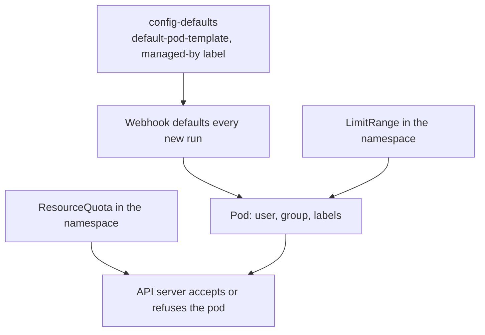

# Limit What Runs Can Use

On a shared cluster, a Task is code from a team that the administrator may not know. By default its pod runs as whatever user the image says, often root, and it may use as much CPU as the node has. This part sets two cluster-wide defaults in `config-defaults`, a default pod template and a managed-by label, then limits a namespace with a ResourceQuota, and shows how Tekton works out the resource requests of a pod with several steps.

## A default pod template for every run

The pod template of one run was covered in the controller module. An administrator sets the same template for every run in `config-defaults`, under the key `default-pod-template`. The value is a pod template written as YAML text inside the ConfigMap. A second key, `default-managed-by-label-value`, sets the value of the label `app.kubernetes.io/managed-by` on the pods that Tekton creates. Its built-in value is `tekton-pipelines`.

Start with a run before the change, so that you have something to compare with. Save this as `task-whoami.yaml`:

```yaml
apiVersion: tekton.dev/v1
kind: Task
metadata:
  name: whoami
  namespace: starfleet
spec:
  results:
    - name: uid
  steps:
    - name: id
      image: busybox:1.37.0
      script: |
        #!/bin/sh
        id -u | tr -d '\n' | tee $(results.uid.path)
```

<!-- astrona:playground:renew -->

Apply it and create a run:

```sh
kubectl apply -f task-whoami.yaml
tkn task start whoami -n starfleet --prefix-name before
```

Wait for it, and read the user id and the label of its pod:

```sh
kubectl wait --for=condition=Succeeded taskrun --all -n starfleet --timeout=120s
kubectl get taskruns -n starfleet -o custom-columns=NAME:.metadata.name,UID:.status.results[0].value
kubectl get pods -n starfleet -L app.kubernetes.io/managed-by
```

The result `uid` is `0`, because the image runs as root, and the label has the value `tekton-pipelines`.

## Change the defaults

Save this as `defaults-patch.yaml`. It sets the two keys and leaves every other key of the ConfigMap alone:

```yaml
data:
  default-managed-by-label-value: "starfleet-ci"
  default-pod-template: |
    securityContext:
      runAsNonRoot: true
      runAsUser: 1000
      runAsGroup: 1000
```

Apply it to the ConfigMap:

```sh
kubectl patch configmap config-defaults -n tekton-pipelines --patch-file defaults-patch.yaml
```

The validating webhook checks the ConfigMap when you apply it, and refuses a value that is not a valid pod template. Create a new run and compare:

```sh
tkn task start whoami -n starfleet --prefix-name after
kubectl wait --for=condition=Succeeded taskrun --all -n starfleet --timeout=120s
kubectl get taskruns -n starfleet -o custom-columns=NAME:.metadata.name,UID:.status.results[0].value
kubectl get pods -n starfleet -L app.kubernetes.io/managed-by
```

The new run reports the user id `1000`, and its pod carries the label `starfleet-ci`. The old run keeps `0` and the old label, because the defaults were written into the objects when they were created. The change reaches only objects created afterwards.

A pod template in a run is merged over this default, and the field in the run wins. A team can therefore set `runAsUser: 2000` in its own run, but cannot remove a setting it does not mention. If you need a rule that no run may break, use admission control in the cluster, such as Pod Security Admission, which is a Kubernetes feature and not a Tekton one.

## Limit a namespace with a ResourceQuota

A default pod template shapes each pod. A ResourceQuota limits the total of a namespace. Save this as `quota-pods.yaml`. It allows no pods at all, which is the simplest way to see the effect:

```yaml
apiVersion: v1
kind: ResourceQuota
metadata:
  name: no-pods
  namespace: starfleet
spec:
  hard:
    pods: "0"
```

Apply it and create a run:

```sh
kubectl apply -f quota-pods.yaml
tkn task start whoami -n starfleet --prefix-name quota
```

Read the condition of the new run after a few seconds:

```sh
kubectl get taskruns -n starfleet
```

The API server refuses the pod, and the controller treats that as a temporary problem. The run is not marked failed. Its `Succeeded` condition says why it waits, and its message names the quota. Delete the quota, and the controller creates the pod on its next try:

```sh
kubectl delete resourcequota no-pods -n starfleet
kubectl get taskruns -n starfleet
```

The run starts and finishes. A quota with realistic numbers works the same way: runs that would go over the limit wait until others finish.

## How Tekton works out the requests of a pod

The steps of a Task run one after the other, but the containers of a pod all count toward its requests. If three steps each ask for one CPU, a naive pod would ask for three CPUs while it only ever uses one. Tekton avoids this. It keeps the largest request among the steps and sets the others to zero, so the pod asks for what the biggest step needs.

Save this as `taskrun-requests.yaml` to see it:

```yaml
apiVersion: tekton.dev/v1
kind: TaskRun
metadata:
  name: requests-demo
  namespace: starfleet
spec:
  taskSpec:
    steps:
      - name: small
        image: busybox:1.37.0
        computeResources:
          requests:
            cpu: 100m
        script: |
          #!/bin/sh
          echo small
      - name: large
        image: busybox:1.37.0
        computeResources:
          requests:
            cpu: 300m
        script: |
          #!/bin/sh
          echo large
```

Apply it and read the requests of each container:

```sh
kubectl apply -f taskrun-requests.yaml
kubectl wait --for=condition=Succeeded taskrun/requests-demo -n starfleet --timeout=120s
kubectl get pod requests-demo-pod -n starfleet -o jsonpath='{range .spec.containers[*]}{.name}{" "}{.resources.requests}{"\n"}{end}'
```

The step `large` keeps its request of `300m`, and the step `small` does not add its own on top. The requests you write on steps are ordinary Kubernetes requests. Limits are not adjusted this way: each container has its own limit.

A LimitRange in the namespace sets default requests and limits for containers that name none. Tekton takes a LimitRange into account when it works out the pod, so a minimum or maximum in the LimitRange applies to the steps like it does to any container.



The diagram shows two kinds of control. Defaults shape the pod before it is created. The quota decides whether the pod is allowed to exist.

You can now set cluster-wide defaults for the pods of all runs, limit a namespace, and read how the requests of a pod come about. The open question is what changes when an operator manages these ConfigMaps for you.

## Common pitfalls

> [!WARNING]
> - **Changing `config-defaults` and expecting running or old runs to change.** The webhook writes defaults when the object is created.
> - **Setting `runAsNonRoot` for images that run as root.** The pod does not start. Choose images that set a user, or set `runAsUser` too.
> - **Removing the quota and not seeing a change at once.** The controller retries on a timer.
> - **Summing the requests of steps by hand.** Tekton keeps the largest request, so the sum overstates the pod.
> - **Relying on a default pod template as a security rule.** A run can override fields. Use Pod Security Admission for a rule that must hold.

## Your mission: Set Defaults For The Installation

You can now change `config-defaults` so that every new run gets the same security settings, and check the effect on a pod. The graded lab asks you to set a default user and a managed-by label in the installation and to prove it with a new run.

The lab runs in its own cluster, so first pause your playground. Nothing in it is lost:

```sh
astrona stop ats-124-playground-020-02
```

Then start the lab:

```sh
astrona run --git ssh://git@github.com/astrona-io/ATS124.git -c sections/section-020/module-02/labs/lab-01
```

The task is on the next page. Solve it on your own first. When you think you are done, send it for grading:

```sh
astrona submit -c sections/section-020/module-02/labs/lab-01
```

When the lab is done, remove it and start your playground again:

```sh
astrona destroy ats-124-lab-020-02
astrona start ats-124-playground-020-02
```
