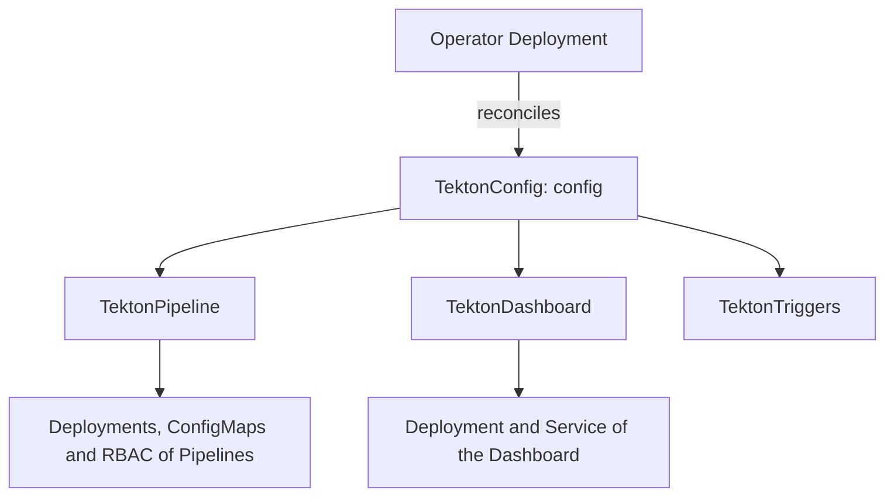

# The Tekton Operator And TektonConfig

Everything so far was done with `kubectl apply` of a release manifest and edits to ConfigMaps. That works for one cluster and one administrator. For many clusters, or for a platform team that wants one place to say what Tekton should look like, the Tekton Operator does the same work from a single custom resource. This part explains what the Operator is, what `TektonConfig` replaces, and the one rule that changes how you edit settings: the Operator owns the ConfigMaps.

## What the Operator is

The Tekton Operator is a separate project from Tekton Pipelines. It is a Deployment with its own CRDs, and it installs and upgrades the Tekton components for you: Pipelines, Triggers, the Dashboard and others. You describe what you want in a custom resource, and the Operator creates the Deployments, ConfigMaps and RBAC that the release manifests would have created.

The playground installed Tekton Pipelines from the release manifest, so the Operator is not there. Check that:

<!-- astrona:playground:renew -->

```sh
kubectl get crd | grep operator.tekton.dev
```

The command prints nothing. Without the Operator CRDs, `kubectl get tektonconfig` is an error. The rest of this part reads manifests as text, because the Operator needs its own installation and a cluster of its own.

## TektonConfig is the one object you edit

The Operator defines a resource called `TektonConfig`, and the Operator expects exactly one, named `config`. Its `spec` has three groups of settings:

- **Which components and how many**: the `profile` chooses a set of components (`lite` installs only Pipelines, `basic` adds Triggers, and `all` adds the Dashboard and more).
- **Where**: `targetNamespace` is the namespace the components are installed in, which is `tekton-pipelines` by default.
- **How each component behaves**: one section per component, such as `pipeline`, `trigger` and `dashboard`, that holds the settings you used in this module.

This is a `TektonConfig` shown as text. Do not apply it in the playground:

```yaml
apiVersion: operator.tekton.dev/v1alpha1
kind: TektonConfig
metadata:
  name: config
spec:
  profile: lite
  targetNamespace: tekton-pipelines
  pipeline:
    default-service-account: builder
    default-timeout-minutes: 30
    enable-api-fields: stable
    metrics.pipelinerun.duration-type: histogram
```

The keys under `pipeline` have the same names as the keys in `config-defaults`, `feature-flags` and `config-observability`. The Operator writes each value into the right ConfigMap. You write the setting once and do not need to know which ConfigMap it belongs to.

## The Operator owns the ConfigMaps

The Operator watches the objects it created. If you edit `config-defaults` by hand, the Operator notices that it differs from `TektonConfig` and writes the old value back. The manual change does not last. That is the rule that matters most when you take over a cluster:

| Where the installation came from | Where to change a setting |
| --- | --- |
| A release manifest and `kubectl apply` | In the ConfigMap, as you did in this module |
| The Tekton Operator | In `TektonConfig`, never in the ConfigMap |

To find out which case you are in, look for the Operator CRDs and for owner references on the Deployments:

```sh
kubectl get crd | grep operator.tekton.dev
kubectl get deployment tekton-pipelines-controller -n tekton-pipelines -o jsonpath='{.metadata.ownerReferences}{"\n"}'
```

In the playground both commands print nothing useful: there is no Operator CRD, and the Deployment has no owner. On an Operator-managed cluster, the owner reference points at a Tekton component resource.



The diagram shows the chain. You edit one object, the Operator turns it into a resource for each component, and each component resource creates the ordinary Kubernetes objects.

## Upgrades with the Operator

An upgrade of the Operator changes the version of the components it installs. Each Operator release carries a fixed set of component versions, so the version of Tekton Pipelines depends on the Operator version that you installed. The Operator applies the new manifests for you. The release notes of the Operator, not only of Pipelines, are what you read before an upgrade.

For this reason many platform teams use the Operator on a cluster that other teams use, and use the plain release manifest on a throw-away cluster such as a training playground.

## Choosing between the two

Use the release manifest when you want to understand every object, pin an exact version, and manage Tekton like any other YAML in a Git repository. Use the Operator when several components must be kept in step across several clusters, or when the platform you run on (for example OpenShift Pipelines, which is built on it) already uses it. The Tekton objects your users see, `Task`, `Pipeline` and the runs, are the same in both cases.

You can now say where a setting must be changed on an installation, depending on how it was made. This finishes the installation topics of the course: you can install, configure, upgrade, observe and limit Tekton Pipelines, and tell who owns the settings.

## Common pitfalls

> [!WARNING]
> - **Editing a ConfigMap on an Operator-managed cluster.** The Operator writes the old value back. Change `TektonConfig`.
> - **Naming the `TektonConfig` anything but `config`.** The Operator works with one resource of that name.
> - **Upgrading Tekton Pipelines with `kubectl apply` on an Operator-managed cluster.** The Operator undoes it. Upgrade the Operator.
> - **Reading only the Pipelines release notes.** The Operator release decides which Pipelines version you get.
