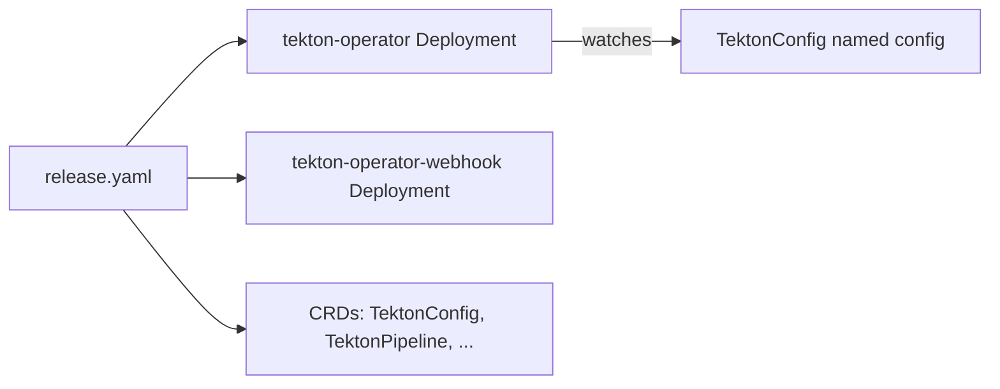

# Install The Operator

The Operator is itself a set of Deployments and custom resource definitions (CRDs). Installing it does not install Tekton Pipelines yet. It only adds the controller that reads a `TektonConfig` and installs Tekton from it.

## Apply the release manifest

<!-- astrona:playground:renew -->

The Operator project publishes a release manifest. The `latest` folder always holds the newest release:

```sh
kubectl apply -f https://storage.googleapis.com/tekton-releases/operator/latest/release.yaml
```

For a production cluster, use a folder named after a release so that the same command gives the same result next week. The folder `previous/<VERSION>/` holds one release. Replace `<VERSION>` with the release you chose.

The manifest creates the namespace `tekton-operator`, the CRDs of the Operator, and two Deployments: `tekton-operator` and `tekton-operator-webhook`.

## Check that it runs

```sh
kubectl get deployments -n tekton-operator
kubectl get crds | grep operator.tekton.dev
```

Both Deployments should show every replica ready. The second command lists the CRDs of the group `operator.tekton.dev`, among them `tektonconfigs`, `tektonpipelines`, `tektontriggers`, `tektonchains` and `tektondashboards`.



The diagram shows that the Operator only watches for a `TektonConfig`. Nothing else is installed until that object exists.

## Why a separate install step

The Operator is the one thing you install by hand. Everything else is a result of the `TektonConfig`, so you can remove or change a component by editing one object.

## Common pitfalls

> [!WARNING]
> - **Using `latest` in production.** A later apply may install a different release.
> - **Installing Tekton Pipelines by its own release manifest as well.** The Operator would manage the same objects as your manifest and overwrite your changes.
> - **Skipping the webhook Deployment check.** The Operator webhook validates the `TektonConfig`; creating one before it is ready can fail.
