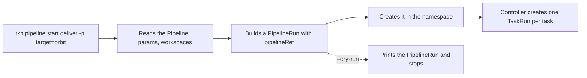

# List, Describe And Start Pipelines

Before you start a Pipeline, you need to know what it expects: which parameters it has, which of them have defaults, and which workspaces it needs. `tkn pipeline describe` answers that, and `tkn pipeline start` then builds the `PipelineRun`. This part applies two Pipelines, reads them with `tkn`, and starts them with parameters, a workspace and a preview.

## Two Pipelines to work with

The first Pipeline, `deliver`, has two pipeline tasks and a result. The parameter `target` has no default, so every run must give it a value. The parameter `tag` has a default. Save this as `pipeline-deliver.yaml`:

<!-- astrona:playground:renew -->

```yaml
apiVersion: tekton.dev/v1
kind: Pipeline
metadata:
  name: deliver
  namespace: starfleet
spec:
  params:
    - name: target
      type: string
      description: Where to deliver
    - name: tag
      type: string
      default: v1
      description: What to deliver
  tasks:
    - name: prepare
      taskSpec:
        params:
          - name: tag
        steps:
          - name: pack
            image: busybox:1.37.0
            script: |
              #!/bin/sh
              echo "Packing $(params.tag)"
              sleep 3
      params:
        - name: tag
          value: $(params.tag)
    - name: ship
      runAfter:
        - prepare
      taskSpec:
        params:
          - name: target
          - name: tag
        results:
          - name: shipped
        steps:
          - name: send
            image: busybox:1.37.0
            script: |
              #!/bin/sh
              printf '%s:%s' "$(params.target)" "$(params.tag)" | tee $(results.shipped.path)
      params:
        - name: target
          value: $(params.target)
        - name: tag
          value: $(params.tag)
  results:
    - name: summary
      type: string
      value: $(tasks.ship.results.shipped)
```

The Pipeline embeds its tasks with `taskSpec`, so there are no separate Tasks to apply. An embedded task must declare the parameters its steps use, and the `params` of the pipeline task pass the Pipeline's values into them. Apply it:

```sh
kubectl apply -f pipeline-deliver.yaml
```

The second Pipeline, `stamp`, needs a workspace. One task writes a file into it and reads it again, so a single pod is enough. Save this as `pipeline-stamp.yaml`:

```yaml
apiVersion: tekton.dev/v1
kind: Pipeline
metadata:
  name: stamp
  namespace: starfleet
spec:
  workspaces:
    - name: notes
  tasks:
    - name: write-and-read
      workspaces:
        - name: notes
          workspace: notes
      taskSpec:
        workspaces:
          - name: notes
        steps:
          - name: write
            image: busybox:1.37.0
            script: |
              #!/bin/sh
              echo "stamped" > $(workspaces.notes.path)/stamp.txt
          - name: read
            image: busybox:1.37.0
            script: |
              #!/bin/sh
              cat $(workspaces.notes.path)/stamp.txt
```

Apply it:

```sh
kubectl apply -f pipeline-stamp.yaml
```

## List and describe

`tkn pipeline list` shows one line for each Pipeline, with its age and the last run:

```sh
tkn pipeline list -n starfleet
tkn pipeline describe deliver -n starfleet
```

The description shows the name and namespace, then a table of the parameters with their type and default, then the results, the workspaces, the tasks with their `runAfter`, and the runs of the Pipeline. The parameter `target` shows no default, and `tag` shows `v1`. This table is what you read before you write a `-p` flag.

```sh
tkn pipeline describe stamp -n starfleet
```

The workspace `notes` is listed. A Pipeline with a workspace cannot run until the run binds it.

## Start a Pipeline

`tkn pipeline start` creates a `PipelineRun`. Pass a parameter with `-p name=value` and follow the logs with `--showlog`. The flag `--use-param-defaults` uses the default of every parameter that has one, so `tkn` does not ask for them:

```sh
tkn pipeline start deliver -n starfleet -p target=orbit --use-param-defaults --showlog
```

The command prints the name of the new `PipelineRun`, then the logs of both tasks in order. Without `--use-param-defaults`, `tkn` asks for each missing parameter on the terminal. In a script there is no terminal, so always give every parameter or use the flag.

A run can also be given a readable name. With `--prefix-name`, `tkn` sets the name to the prefix and a random suffix:

```sh
tkn pipeline start deliver -n starfleet -p target=dock -p tag=v2 --prefix-name nightly --showlog
```

## Bind a workspace

For `stamp`, the run must say what backs the workspace. The `--workspace` flag takes a comma-separated list. For a short-lived workspace that lives in one pod, `emptyDir` is enough:

```sh
tkn pipeline start stamp -n starfleet --workspace name=notes,emptyDir= --showlog
```

The log shows `stamped`. When the tasks run in separate pods, an `emptyDir` does not work, because each pod gets its own. For that case the flag takes a claim or a template file instead:

| Value of `--workspace` | Backed by |
| --- | --- |
| `name=notes,emptyDir=` | An empty folder that lives with one pod |
| `name=notes,claimName=my-pvc` | An existing PersistentVolumeClaim |
| `name=notes,volumeClaimTemplateFile=pvc.yaml` | A new PersistentVolumeClaim created from the file, deleted with the run |
| `name=notes,config=my-config` | A ConfigMap (read-only) |
| `name=notes,secret=my-secret` | A Secret (read-only) |

## Preview before you create

`--dry-run` prints the `PipelineRun` that would be created, and creates nothing. Combine it with `--output yaml`:

```sh
tkn pipeline start deliver -n starfleet -p target=harbor --use-param-defaults --dry-run --output yaml
```

The output is a `PipelineRun` with `generateName`, the `pipelineRef` and the parameters, including the default for `tag`. Save it into a file if you want to keep the run in Git. List the runs to prove that nothing was created:

```sh
tkn pipelinerun list -n starfleet
```



The diagram shows what `tkn` does and what it leaves to the controller. With `--dry-run` it stops before it creates the object.

You can now read what a Pipeline needs and start it in different ways. The open question is how to read the runs you just started.

## Common pitfalls

> [!WARNING]
> - **Starting without `--use-param-defaults` in a script.** `tkn` waits for input on a terminal that is not there.
> - **Binding a workspace with `emptyDir` when tasks run in different pods.** The tasks do not see each other's files.
> - **Starting a Pipeline in the wrong namespace.** The same Pipeline name can exist in two namespaces. Use `-n` or a context with a namespace.
> - **Believing `--dry-run` checks the Pipeline.** It prints the run; the webhook checks it when it is really created.
