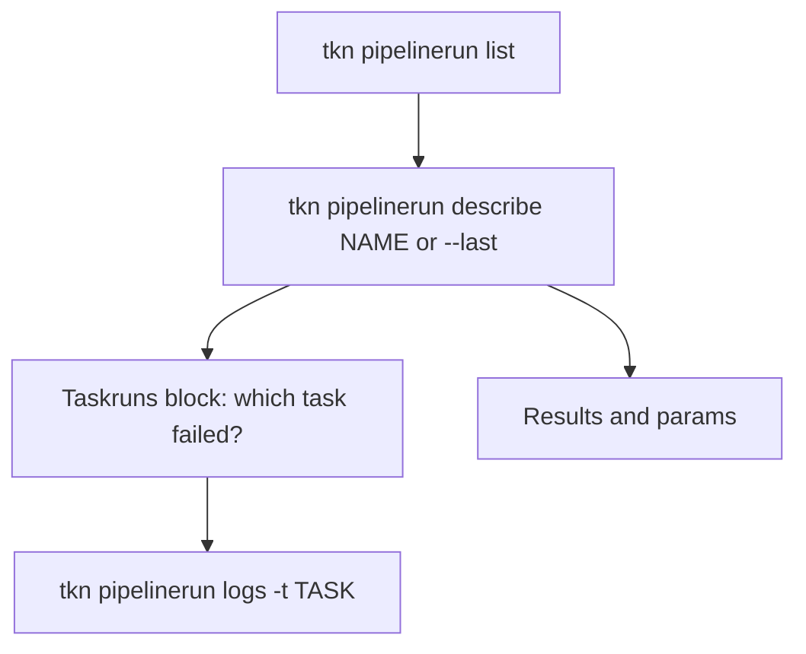

# Read PipelineRuns And Their Logs

A `PipelineRun` is a group of TaskRuns, so reading one means reading its status, its results and the logs of several pods. `kubectl` needs a label selector and a loop for that. `tkn pipelinerun describe` and `tkn pipelinerun logs` put it together. This part reads the runs from the previous part, follows a run while it works, and reads one task of a run.

## List the runs

With the Pipelines from the previous part and a few runs started, list them:

<!-- astrona:playground:renew -->

```sh
tkn pipelinerun list -n starfleet
```

The table has one line for each `PipelineRun`, newest first: name, start time, duration and status. Add the name of a Pipeline to see only its runs, and `--no-headers` to drop the first line:

```sh
tkn pipelinerun list deliver -n starfleet
tkn pipelinerun list deliver -n starfleet --no-headers
```

The short name `pr` works too: `tkn pr list`.

## Describe one run

`tkn pipelinerun describe` prints everything about a run. With `--last` it picks the newest run, so you do not copy a name. Add the name of a Pipeline to pick the newest run of that Pipeline:

```sh
tkn pipelinerun describe --last -n starfleet
tkn pipelinerun describe --last deliver -n starfleet
```

The description has these blocks, from top to bottom:

| Block | What it tells you |
| --- | --- |
| Header | Name, namespace, the Pipeline it refers to, ServiceAccount, timeout and labels |
| Status | When it started, how long it took, and the `Succeeded` state |
| Results | The Pipeline results, such as `summary` |
| Params | The parameters the run passed, including defaults |
| Taskruns | One line for each task: the TaskRun name, the pipeline task name, duration and status |

The last block is the most useful one when a run fails. It shows which task failed without a label selector. Take the TaskRun name from it and describe that TaskRun with `tkn taskrun describe`.

## Read the logs

`tkn pipelinerun logs` reads the logs of every task of the run, in the order of the tasks. The name of the task and the step is put in front of each line:

```sh
tkn pipelinerun logs --last -n starfleet
```

Use `-f` (`--follow`) to keep reading while the run is still working. Start a run in one terminal with the Pipeline `deliver` and follow it from another:

```sh
tkn pipeline start deliver -n starfleet -p target=quay --use-param-defaults
tkn pipelinerun logs --last -f -n starfleet
```

The first command prints the run name and returns at once. The second shows the logs as the steps print them, and stops when the run ends. To read only one pipeline task, name it with `-t` (`--task`):

```sh
tkn pipelinerun logs --last -t ship -n starfleet
```

Only the lines of the task `ship` are shown. This is the command to use for a Pipeline with a noisy first task.

A run that failed before any pod was created has no logs. `tkn` says so, and the answer is in the `Succeeded` condition. Read it with `describe`, as in the controller module.

## Ask for another format

The `-o` flag works on `describe` the same way as for tasks. A script reads names or JSON:

```sh
tkn pipelinerun list deliver -n starfleet -o name
tkn pipelinerun describe --last -n starfleet -o yaml
```

The YAML is the full `PipelineRun` as the API server stores it, with `status.childReferences` and the results. A value in this output is also in `kubectl get pipelinerun -o yaml`, because both tools read the same object.



The diagram shows the reading order: find the run, describe it, find the task, read that task's log. The same order as in the triage routine.

You can now list, describe and read the runs of a Pipeline. The open question is what to do with a run you no longer want, or want again.

## Common pitfalls

> [!WARNING]
> - **Using `--last` in a namespace where several people start runs.** The newest run may be someone else's. Name the Pipeline: `--last deliver`.
> - **Reading only the Status block.** `Succeeded` shows that every task passed, not that the result is right. Read the Results block.
> - **Following logs with `-f` for a run that already ended.** It prints the logs once and returns.
> - **Expecting logs for a run that failed before it created a pod.** The reason is in the condition.
