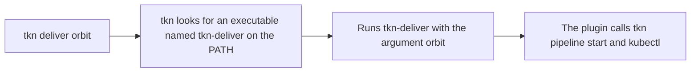

# Plugins And Scripts

`tkn` is small on purpose. When your team does the same three commands every day, a script or a plugin is better than a page in a wiki. This part writes a small shell script that uses `tkn` safely, then turns it into a `tkn` plugin, so that the team types `tkn deliver` instead of a long command.

## Rules for using tkn in a script

A script has no terminal and no human to answer a question. Four habits keep `tkn` predictable in one:

| Habit | Why |
| --- | --- |
| Always pass `-n NAMESPACE` | A script must not depend on the current kubeconfig context |
| Always pass every parameter, or `--use-param-defaults` | `tkn` otherwise asks on the terminal |
| Use `-f` on delete commands | Without it the command waits for an answer |
| Use `-o name` or `-o json` for values you parse | The table output is for people and can change |

## A delivery script

Save this as `deliver.sh`. It starts the Pipeline `deliver` with a target, prints the name of the run, waits for it to end, and ends with the exit code of the result:

<!-- astrona:playground:renew -->

```sh
#!/bin/sh
# usage: deliver.sh TARGET
set -eu

NS=starfleet
TARGET="$1"

# Start the run. -o name prints the resource name, so the script can use it.
RUN=$(tkn pipeline start deliver -n "$NS" -p "target=$TARGET" --use-param-defaults --prefix-name script -o name | sed 's|.*/||')
echo "Started $RUN"

# Wait until the Succeeded condition is True or False.
kubectl wait --for=condition=Succeeded "pipelinerun/$RUN" -n "$NS" --timeout=300s >/dev/null 2>&1 || true
STATUS=$(kubectl get pipelinerun "$RUN" -n "$NS" -o jsonpath='{.status.conditions[?(@.type=="Succeeded")].status}')
echo "Result: $(kubectl get pipelinerun "$RUN" -n "$NS" -o jsonpath='{.status.results[?(@.name=="summary")].value}')"

[ "$STATUS" = "True" ]
```

The first command asks `tkn` to print only the name. For `tkn pipeline start`, the `-o name` flag prints the name of the object it created. The script reads the result with `kubectl` because a jsonpath reads it in one line. `kubectl wait --for=condition=Succeeded` returns with an error if the run fails, which the `|| true` ignores, because the script reads the status itself right after. The last line is the exit code: success only when `Succeeded` is `True`.

Make it executable and run it:

```sh
chmod +x deliver.sh
./deliver.sh dock
echo "exit code: $?"
```

The script prints the run name and the result `dock:v1`, and the exit code is `0`.

## A tkn plugin

`tkn` looks for plugins. An executable file whose name starts with `tkn-`, in a folder on your `PATH`, becomes a subcommand: a file named `tkn-deliver` is started by `tkn deliver`, and the arguments after the word are passed to it. `tkn` also looks in the folder `$HOME/.config/tkn/plugins`.

Turn the script into a plugin. Create a folder for it and put it on the `PATH` for this terminal:

```sh
mkdir -p "$HOME/tkn-plugins"
cp deliver.sh "$HOME/tkn-plugins/tkn-deliver"
chmod +x "$HOME/tkn-plugins/tkn-deliver"
export PATH="$HOME/tkn-plugins:$PATH"
```

Now run it as a `tkn` command:

```sh
tkn deliver orbit
```

It starts a run for the target `orbit`, as the script did. The plugin has no special API: it is a program that `tkn` starts, and it can be written in any language. This is how the Tekton project ships optional tools, such as the plugin for the Tekton Results API.



The diagram shows that a plugin is only a lookup rule and a program. Everything the plugin does, it does by calling the same commands you already know.

## Clean up what you created

Remove the plugin when you do not need it, so that it does not stay on the `PATH` of later terminals. The `export` above only affected this terminal, so a new terminal does not have it. Remove the files:

```sh
rm -r "$HOME/tkn-plugins"
rm -f deliver.sh
```

You can now run `tkn` safely from a script and extend it with your own subcommand. This finishes the `tkn` module: you can choose the cluster, start Tasks and Pipelines, read runs, stop them, repeat them and clean up.

## Common pitfalls

> [!WARNING]
> - **Letting a script use the current context.** Pass `-n`, and `--context` when the cluster matters.
> - **Parsing the table output.** It is for people. Use `-o name`, `-o json` or `kubectl -o jsonpath`.
> - **Naming a plugin without the `tkn-` prefix.** `tkn` does not find it.
> - **Forgetting `chmod +x`.** A plugin that is not executable is ignored.
> - **Putting secrets in plugin arguments.** Arguments show up in the process list. Read secrets from the environment or a file.
